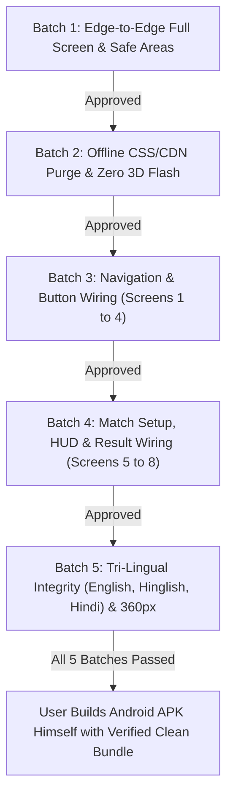

# 📱 Final Pre-Release Audit & Android APK Optimization Plan (Batch-Wise Architecture)

> **Role:** Principal Android WebView Mobile Game QA & Frontend Architect  
> **Project:** Pen Fight — Desk Wars  
> **Target Deliverable:** 100% Offline Production-Ready Webview Bundle (Ready for User to Build APK)  
> **Status:** 🟡 Updated with Tri-Lingual Hinglish Scope & User Build Sovereignty (Zero Code Execution Phase)  
> **Core Principle:** Chhote Atomic Batches • Audit ke sath turant Concrete Solution • User Builds APK • Har Batch ka alag Approval Gate  

---

## 🛑 User Invariants & Governance

> [!IMPORTANT]
> **1. Anti-Overwhelm Batch Protocol:**
> Poora audit ek sath nahi hoga. 5 chhote atomic batches (Batches 1 to 5) me audit hoga aur har batch ke sath uska **concrete code fix/solution** deliver hoga. Har batch ke baad user approval anivarya hai.
>
> **2. Tri-Lingual Language Scope (`english`, `hinglish`, `hindi`):**
> Game me English aur Shuddh Hindi ke sath-sath **Desi Classroom Hinglish** (Teacher remarks, chalkboard alerts, student nicknames, casual slangs) ka bhi poora audit hoga.
>
> **3. User Build Sovereignty (User Khud APK Banayega):**
> AI ka kaam code me sabhi full-screen scaling, safe-area insets, offline CSS bundling, 3D transition shield, aur button wiring ko 100% test karke fix karna hai. **Final Android APK build user khud karega.**

---

## 📦 Batch 1: Edge-to-Edge Full-Screen Scaling & Safe Area Insets

### 🎯 Scope
Android phones (360x640, 390x844, 412x915) par fixed `w-[390px]` letterboxing hatana aur camera notch/gesture bar safe areas set karna.

### 🔍 Audit Targets
* `index.html` aur CSS files (`menu.css`, `campaign.css`, `compass.css`, `match_setup.css`, `splash.css`) me fixed `w-[390px]` aur `sm:h-[844px]` containers.
* Top headers aur bottom action buttons ka status bar, punch-hole camera aur navigation gesture pill se takrana.

### 💡 Concrete Solution
1. **Full-Screen Responsive Wrappers:**
   * Outer containers: `w-full h-full min-h-[100vh] min-h-[100dvh] flex flex-col`.
   * Inner content wrappers: `max-w-[460px] mx-auto w-full flex-1 flex flex-col justify-between`.
2. **Safe Area Insets (CSS env):**
   * Top Headers: `padding-top: max(12px, env(safe-area-inset-top))`.
   * Bottom Navigation/CTAs: `padding-bottom: max(14px, env(safe-area-inset-bottom))`.
3. **Android 9-15 WebView Fallback:** `100vh` fallback before `100dvh`, non-standard Tailwind v4 classes ko standard CSS me convert karna.

---

## 📦 Batch 2: 100% Offline APK Guarantee & Zero 3D Canvas Flash

### 🎯 Scope
Airplane Mode ON me bina internet ke 100% offline chalna aur page switch karte waqt 3D canvas ka zero flash.

### 🔍 Audit Targets
* `` aur Google Fonts internet dependency.
* Overlays switch karte waqt beech me 3D table ka micro-flash dikhna.

### 💡 Concrete Solution
1. **Offline CSS Bundling:**
   * Tailwind CDN script dependency ko remove karke sabhi required utilities ko standalone local CSS me compile/inline karna.
   * Airplane mode me zero network calls ki guarantee.
2. **Opaque Parchment Transition Shield:**
   * Jab tak match start na ho (`#game-hud-overlay` visible na ho), 3D canvas `#canvas-container` ke aage **100% opaque notebook parchment background** active rahega. Kisi bhi do screens ke beech 3D table flash nahi hoga.

---

## 📦 Batch 3: Button Wiring & Click Audit — Part 1 (Screens 1 to 4)

### 🎯 Scope
Admission Form, Main Menu Hub, Campaign Map, aur Tin Compass Box ke sabhi clickable elements ka zero-dead-click audit.

### 🔍 Audit Targets & Concrete Solutions
* **Page 1 (Admission Form):**
  * Boy / Girl / Custom avatar selection sync.
  * 4 Houses selector (Yellow, Green, Red, Blue).
  * English vs Hindi school medium toggle.
  * Name & School Name inputs (`window.applySchoolName()`).
  * `[ENTER CLASSROOM ➔]` CTA transition.
* **Page 2 (Main Menu Hub):**
  * Medium pill toggle (English ⇄ Hindi).
  * Gear icon ⚙️ ➔ Trophy Cabinet Settings tab.
  * Student ID Card tap ➔ Career Dossier modal.
  * Rank/XP bar tap ➔ 11-Level Ladder merit screen.
  * Center CTA `[⚡ TOSS + PLAY ➔]` ➔ Instant bot duel.
  * 4 Mode cards (`Story Mode`, `Pass & Play`, `Compass Box`, `Trophy Rack`).
* **Page 3 (Campaign Map & Chit):**
  * Header `← HUB` return button.
  * 11 Desk nodes tap ➔ Yellow Chit popup with opponent caricatures.
  * Yellow chit `⚔️ FIGHT! ➔` aur `🔄 WARMUP` triggers.
* **Page 4 (Tin Compass Box):**
  * 6 Pen Slots (Reynolds, Nataraj, Butterflow, Pilot V5, Trimax, Apsara Platinum).
  * `EQUIP FOR BATTLE` CTA button ➔ Saves to localStorage and updates active 3D pen.

---

## 📦 Batch 4: Button Wiring & Click Audit — Part 2 (Screens 5 to 8)

### 🎯 Scope
Match Setup, Live HUD, Pause Drawer, Result Certificate, aur Trophy Cabinet ke sabhi triggers ka audit aur wiring solution.

### 🔍 Audit Targets & Concrete Solutions
* **Page 5 (Match Setup):**
  * Single Player vs 2-Player Pass & Play tab switches.
  * Easy, Normal, Hard difficulty pills selection.
  * Pass & Play P1 vs P2 pen selectors.
  * `START DUEL` & `START PASS & PLAY` match launch hooks.
* **Page 6 (Live HUD & Pause Drawer):**
  * Pause button `⏸️` ➔ Pause drawer toggle.
  * `▶ RESUME`, `🔄 RE-TOSS ROUND`, `🚪 FORFEIT TO HUB`.
  * Player Dossier badges tap.
* **Page 7 (Match Result Certificate):**
  * Victory State: `NEXT CLASSMATE ➔`, `REMATCH 🔄`, `RETURN TO HUB 🚪`.
  * Defeat State: `REMATCH ⚔️`, `RETURN TO HUB 🚪`.
  * Promotion State: `CLAIM RANK ➔`, `RETURN TO HUB 🚪`.
* **Page 8 (Trophy Cabinet & Settings):**
  * Tabs: `🏆 BADGES` vs `⚙️ RULES & SETTINGS`.
  * 16 Badge Pins tap ➔ Inspect modal sheet (`[PIN TO BADGE]`, `[CLOSE]`).
  * SFX volume slider, Ambiance volume slider, Test sample, Ambiance toggle switch.

---

## 📦 Batch 5: Tri-Lingual Language Integrity (English, Hinglish & Hindi) & 360px Small Screen Audit

### 🎯 Scope
Game me **English**, **Desi School Hinglish**, aur **Everyday Hindi** teeno modes ka comprehensive audit + 360px compact screens par zero text cutoff.

### 🔍 Audit Targets & Concrete Solutions
* **1. English Medium Mode (`english`):**
  * Authentic standard nostalgic school terms intact (`STUDENT BATTLE PASS`, `TOSS & PLAY`, `1st Bencher`, `Story Mode`).
* **2. Desi Classroom Hinglish Mode (`hinglish`):**
  * Natural conversational Hinglish phrases verify karna:
    * Blackboard alerts: `"ROUND DRAW! RE-FLICK"`, `"RE-TOSS ROUND"`.
    * Chit texts: `"Rule #1: Desk se neeche gira pen out maana jayega!"`.
    * Teacher Remarks: `"Sharma Sir (Maths & Examination Proctor)"`, `"Sharmila Ma'am (Class Teacher)"`.
    * Pen Mods & Slangs: `"Double Rubber Band + M-Seal Cap Weight"`, `"Samosa Coupon"`, `"Bunty Backbencher"`.
* **3. Everyday Hindi Mode (`hindi`):**
  * Shuddh, natural bol-chal ki Hindi bina bureaucratic jargon ke (`खिलाड़ी पहचान पत्र`, `खेल शुरू करें ▶`, `कक्षा 7वीं - ब`).
* **4. Small Screen Verification (360x640):**
  * 360px width par sabhi lambe Hindi/Hinglish labels me zero text truncation, zero line-break overlaps, aur clean font size scaling.

---

## 🚀 5. Final Handover & User APK Build Workflow

* **AI Deliverables (Batches 1 to 5):**
  * Sabhi 5 batches ke concrete code fixes, tests aur verification receipts (`git commits` + screenshots).
  * 100% offline, zero-network, edge-to-edge full-screen web bundle.
* **User Deliverable (APK Generation):**
  * Saare sudharo ke baad **User khud Android Studio / Flutter CLI se production APK/AAB build karega**.

---

## 🛑 Strict Approval Gate (Abhi Koi Code/Audit Execute Nahi Hoga)

> [!IMPORTANT]
> **User Directive Honored:** Abhi kisi bhi file me **koi code badlav ya audit run NAHI kiya gaya hai**. 
> User ne abhi approval nahi diya hai, isliye engine strictly **Pure Discussion / Pre-Audit** mode me locked hai. 
> Jab aap is updated batch-wise plan ko check karke **"Approved"** kahenge, tabhi hum **Batch 1 (Edge-to-Edge Full Screen & Safe Areas)** se shuru karenge.
