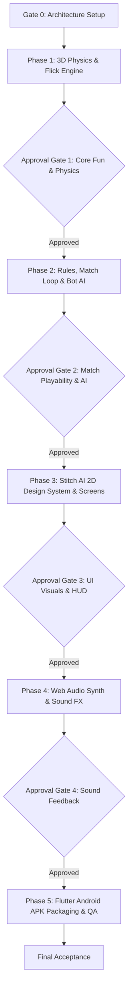

# 🎯 Production Development Plan: Pen Fight — Desk Wars
**Target Platform:** 100% Offline Android Mobile Game (Touch-First • Portrait 9:16 Layout • Flutter Container)  
**Project Sovereignty:** 100% Standalone Offline Game Repository (`D:\FInal`)  
**Game Title:** **Pen Fight: Desk Wars — The Last Bench Game**  
**Local Asset Root:** `assets/` (All 3D models, textures, rooms, audio 100% self-contained)  
**Active Development Master:** `MASTER_DEVELOPMENT_PLAN.md` & `STITCH_AI_MASTER_PROMPT.md` (Project Root)  

---

## 🛑 Strict Governance & Iron Sovereignty Rules

1. **Rule 1 (Sole Master Driver & Roadmap):**
   - Root plan hi poora roadmap chalayega (`MASTER_DEVELOPMENT_PLAN.MD` aur `STITCH_AI_MASTER_PROMPT.MD`).
   - Game architecture, 11 levels (Naya Khiladi ➔ Last Bench Legend), 6 authorized pens, 16 badges, 7 ranking tiers, aur Stitch 2D UI sirf aur sirf inhi root plans ke hisab se govern honge.
2. **Rule 2 (Silent Emergency Physics Reference Dictionary):**
   - `D:\PAnfight\CLEAN_ROOM_SPECIFICATION.MD` sirf ek silent physics reference dictionary (help desk) ki tarah background me rahega.
   - Agar kisi physics formula, Center of Mass (COM), friction constant, ya math equation me AI kahin phanse, toh wahan se help li ja sakti hai.
   - Par uska koi level, student/opponent name (e.g. Bunty/9A), ya roadmap root game me execute nahi hoga. Help lene par AI chat me explicitly formula declare karega.
3. **Rule 3 (100% Standalone Repository Sovereignty):**
   - Game ka 100% saara data, assets, code, audio, textures, physics aur documentation isi project folder (`D:\FInal`) me local rahega.
   - Root codebase me koi external import ya direct path dependency nahi hogi, taaki GitHub par push karne par yeh repository bina kisi external directory ke 100% complete aur playable rahe.
4. **Rule 4 (Step-by-Step Approval & Gate Execution):**
   - **Step-by-Step Approval:** Har ek single step complete hone ke baad AI document me us step ko `[x] COMPLETED` mark karega, live proof/receipt chat me batayega, aur User se explicitly approval mangega: *"Step X complete ho gaya hai. Kya agle step ke liye APPROVED hai?"* User ke explicitly bole bina agla step shuru **NAHI** hoga.
   - **Phase Gate Approval:** Poora Phase khatam hone par Approval Gate ka comprehensive test pass hoga aur User se final Phase Approval lena mandatory hoga.
5. **Zero Unsolicited Deviation:**
   - AI apne man se koi library, formula, pen count, ya UI structure change/skip nahi karega.
6. **No 44-Pen / External Bloat (Strict 6 Pens & 11 Levels):**
   - Strict 6 pens: *Reynolds Trimax, Reynolds 045, Cello Butterflow, Pilot V5, Nataraj 621, Apsara Platinum*.
   - Strict 11 levels: *Naya Khiladi (0 XP) ➔ Last Bench Legend (3250 XP)*.
   - Strict 16 badges & 7 ranking tiers.
7. **Clean Layer Separation:**
   - **3D World (Three.js + Rapier):** Desk, Pens, Lighting, Physics Collisions, Flick mechanics.
   - **2D UI Layer (HTML/CSS via Stitch):** Top Scoreboard, Power Bar, Menus, Cards, Trophy Cabinet.
8. **Rule 8 (Strict Mobile-First & Touch-First Architecture):**
   - Yeh game **100% Android Mobile Touchscreen (Portrait 9:16 / 9:20)** ke liye ban raha hai.
   - Koi bhi PC desktop pattern jaise physical keyboard shortcuts (`KeyR`), mouse hover effects (`:hover`), ya desktop-style horizontal bars game me nahi chalenge.
   - Saari UI elements, touch targets (minimum 48px), responsive safe areas, aur flick gestures sirf aur sirf Android mobile screen ko dhyan me rakh kar design aur build honge.
9. **Rule 9 (Phase 1 Engine Freeze & Strict Lock):**
   - **Phase 1 (Core 3D Physics & Rendering Engine) 100% Complete aur PERMANENTLY LOCKED hai.**
   - User Directive: *"Phase 1 ko lock kar do bina meri approval ke engine me koi change nahi hoga."*
   - Core files: `js/pens.js`, `js/desk.js`, Three.js scene setup, 120Hz Rapier WASM simulation loop, 6 parametric pen geometries, mass distribution, friction constants, table boundaries, aur drop detection strictly FROZEN hain.
   - Aage ke sabhi phases (Phase 2 Rules & AI, Phase 3 Stitch UI, Phase 4 Audio) Phase 1 ko immutable (unalterable) base foundation maan kar chalenge. Bina explicit user approval ke engine files me koi bhi badlav karna strictly prohibited hai.
10. **Rule 10 (Official Google Play Store Policy & Architecture Compliance):**
   - Game ka koi bhi code, architecture ya asset Google Play Store ki official policies ke khilaf nahi jayega.
   - **Compliance Tools & Routing Boundaries:**
     - **`retrieving-developer-knowledge`:** Official Google Developer documentation se Target SDK API level 34/35 requirements, 64-bit ABI rules, aur Data Safety declarations fetch aur verify karne ke liye use hoga.
     - **`search_web`:** Google Play Developer Policy Center (`support.google.com/googleplay/android-developer`) se latest store policy updates (Families Policy, 20-tester requirement, zero data tracking policies) live verify karne ke liye use hoga.
     - **`android-cli`:** Android SDK platform tools, Gradle configurations (`minSdkVersion 24`, `targetSdkVersion 34/35`, NDK 64-bit ABI filters), aur local emulator/device testing ke liye use hoga.
   - **Data Safety Mandate:** Game 100% offline rahega (`localStorage` only). Zero analytics, zero unnecessary permissions (`INTERNET`, `CAMERA`, `STORAGE` etc. blocked from manifest), taaki Google Play Data Safety form 100% "No data collected, No data shared" rahe.

---

## 🎖️ Complete Level Ladder & Pen Inventory Specifications

### 📈 11 Levels & Progression (Kahan aur Kaise Banenge)
* **Kahan dikhega:** Player Profile aur dedicated **"Level Journey Ladder"** screen par (School merit list / classroom journey design).
* **Phases ka batwara:**
  * **Phase 2 (Visual UI - Step 2.3):** 11-step visual merit ladder screen banegi (har step tappable hoga, lock/unlocked status aur XP requirement dikhayega).
  * **Phase 4 (Logic & Storage - Step 4.3):** XP calculation engine, level-up trigger, aur `localStorage` save system implement hoga.
* **11 Levels List:**
  1. **Level 1 — Naya Khiladi:** 0 XP (Starting Tier)
  2. **Level 2 — Bench Beginner:** 100 XP
  3. **Level 3 — Pen Rookie:** 250 XP
  4. **Level 4 — Desk Challenger:** 450 XP
  5. **Level 5 — Flick Expert:** 700 XP
  6. **Level 6 — Class Champion:** 1000 XP
  7. **Level 7 — Pen Master:** 1350 XP
  8. **Level 8 — Desk Legend:** 1750 XP
  9. **Level 9 — School Star:** 2200 XP
  10. **Level 10 — Grand Champion:** 2700 XP
  11. **Level 11 — Last Bench Legend:** 3250 XP (Maximum / Grand Finale)

### 🖋️ 6 Authorized Pens & Tin Compass Box (Player Ko Apne Jeete Pen Kahan Dikhenge)
* **Kahan dikhega:** Player ko apne saare unlocked/jeete hue pens **"Tin Compass Box" (Pencil Geometry Box Screen)** ke andar 6 structured slots me dikhenge:
  * Box open hone par 6 pen cards aayenge (3D preview, Weight, Length, Friction, Accuracy stat bars, aur Special Trait).
  * Jo pen player jeet chuka hai wo unlocked aur **"Equip / Select"** karne ke liye ready rahegi.
* **Phases ka batwara:**
  * **Phase 1 (3D Mesh & Physics):** 6 Pens ki 3D geometry aur Rapier rigid-body physics (`js/pens.js`) — *Already Done*.
  * **Phase 2 (Visual UI - Step 2.3):** Nostalgic Tin Compass Box Screen aur Pen selection cards ka UI layout.
  * **Phase 4 (Logic & Dynamic Swapping - Step 4.3):** Pen unlock progression (Levels jeet kar pen unlock hona) aur selected pen ka live 3D table par spawn hona.
* **6 Pens List & Traits:**
  1. **Reynolds 045:** Classic transparent ballpoint (Default Unlocked - Balanced).
  2. **Cello Butterflow:** Smooth glider with rubber grip (Level 3 Unlock - Low Friction).
  3. **Pilot V5:** Needle-point precision pen (Level 5 Unlock - Fast Sharp Cut).
  4. **Nataraj 621:** Classic red-black wooden hexagonal pencil (Level 7 Unlock - Long Lever Arm).
  5. **Apsara Platinum:** Extra dark dense hexagonal pencil (Level 9 Unlock - High Mass Balance).
  6. **Reynolds Trimax:** Heavy triangular tank (Level 11 Grand Prize - Anti-Roll Desk Champion).

---

## 📊 Current Execution Status & Phase Health (Zameeni Haqeeqat)

Pehle external references ke confusion ki wajah se phases strictly serial order me execute nahi hue the aur kai hisse adhe chhut gaye the. Yeh raha har phase ka unvarnished audit ledger:

| Phase | Naam | Current Status | Kya Ho Chuka Hai (Done) | Kya Adha / Baki Hai (Pending Debt) |
| :--- | :--- | :--- | :--- | :--- |
| **Phase 1** | Core 3D Desk & Physics Engine | 🔒 **100% Complete & LOCKED** | Rapier 120Hz WASM physics, drag flick parabola ($\text{pull}^{1.45}$), 6 procedural 3D pens (`js/pens.js`), cel-shaded outlines, vertical desk ($0.70m \times 1.00m$), out-of-bounds drop settlement, 6-pen sandbox selector, pure decoupling | **LOCKED BY USER (FROZEN):** Zero changes permitted to engine without explicit user approval. |
| **Phase 2** | Rules, Match Loop & Bot AI | 🟡 **40% (In Progress)** | Step 2.1 Match Loop & Turns (`js/rules.js`), Step 2.2 Bot AI (`js/bot.js`) complete & verified | Step 2.3 Pass & Play 2P Mode, Step 2.4 Progression & Badges (`progression.js`), Step 2.5 LocalStorage Persistence (`storage.js`) |
| **Phase 3** | Stitch 2D UI & Nostalgia Screens | ⚪ **0% (Waiting Gate 2)** | Design specs & reference images ready | Steps 3.1-3.9: Screen-by-Screen Verifiable Pipeline (Tokens, Splash/ID, Main Menu, Campaign Map, Compass Box, Match Setup, Transparent HUD, Result Certificate, Trophy Shelf & Settings) |
| **Phase 4** | Audio Synthesizer & SFX | ⚪ **0% (Waiting Gate 3)** | Audio assets preserved in `assets/audio/` | Step 4.1 Standalone Web Audio synth, Step 4.2 SFX slotting to live match events, Step 4.3 Classroom ambiance loop |
| **Phase 5** | Google Play Compliant Android Packaging | ⚪ **0% (Not Started)** | None (Strict approval gate rule ke tehat intentionally untouched) | Step 5.1 Policy Pre-flight (`retrieving-developer-knowledge`), Step 5.2 Flutter Container, Step 5.3 Gradle 64-bit Setup (`android-cli`), Step 5.4 Families Compliance, Step 5.5 Production Release `.aab` |

---

## 🗺️ Master Phase Map & Approval Gates

---

## 📱 Mobile-First Sovereignty (Kahan AI Ne Web Ka Kaam Kiya Tha Aur Kahan Sudhaar Hoga)

Yeh game **100% Android Mobile Touchscreen (Portrait 9:16 Layout)** ke liye ban raha hai. Purani AI ne kahan-kahan desktop/web ke patterns inject kiye the, uska exact audit:

1. **PC Keyboard Shortcut (`js/main.js`):**
   * Physical keyboard listener `window.addEventListener('keydown', e => e.code === 'KeyR')` lagaya tha, jabki mobile device me physical keyboard nahi hota.
2. **Desktop HTML `<select>` Dropdowns (`index.html`):**
   * Top bar me standard browser desktop dropdowns lagaye the, jabki mobile UI me thumb-friendly touch cards ya bottom-sheets hoti hain.
3. **PC Landscape Camera Viewport (`js/main.js`):**
   * Camera calculation me `if (aspect >= 1.2)` (PC/Laptop widescreen) ko priority di gayi thi, jabki primary target mobile portrait vertical desk view hai.
4. **Horizontal Overcrowded Header (`index.html`):**
   * Top bar me 5-6 buttons aur controls ek hi line me horizontal flex the jo wide laptop screen ke hisab se the, vertical mobile screen par wo cut/squeeze hote hain.
5. **CSS `:hover` Pseudo-Classes (`index.html`):**
   * Desktop mouse hover states lagaye the jo mobile touch par sticky tap bug ban jate hain.

**Why WebGL/HTML was used:**
Architecture me Three.js + Rapier WASM ko Flutter Android container (`webview_flutter`) ke andar offline APK ke roop me package kiya ja raha hai (Phase 5). Lekin iska UI aur interaction **Desktop Web jaisa nahi, balki 100% Mobile Touch-First** hoga.

---

## 🧭 Feature-to-Phase Mapping (Easy/Normal/Hard & Scorecard Ka Asli Ghar)

Aapke dono sawalon ki poori clarity yeh hai ki yeh dono features kis-kis phase me aane the aur AI ne kahan confusion kiya:

### 1. 🎚️ Easy / Normal / Hard (Difficulty Toggle)
* **AI Logic & Kinematics (Engine me kahan chalega):** **Phase 2 (Step 2.2 — Mathematical PCOpponentController)**
  * *Easy:* High aim error spread ($\pm 16^\circ$), weak punch speed.
  * *Normal:* Realistic human error spread ($\pm 6.5^\circ$), balanced approach.
  * *Hard:* Sharp aim ($\pm 3^\circ$), high speed, aur 60% spin cut-shots.
* **Visual UI (Kahan dikhega):** **Phase 3 (Step 3.4 — Match Setup Screen)**
  * Stitch AI jab match setup screen banayega, wahan player friendly classmate card ke sath **Easy / Normal / Hard** chunega.
* **Phase 1 Resolution & Clean-up (Sahi Kiya Gaya):** Phase 1 ke sandbox se Easy/Norm/Hard buttons aur out-of-order difficulty logic ko 100% hata diya gaya hai. Phase 1 ab sirf pure 3D physics verification ke liye hai. Yeh feature apne nirdharit Phase 2 (Bot Kinematics) aur Phase 3 (UI Setup) me implement hoga.

### 2. 📋 Score Card (Scoreboard & Match Result)
* **Match Rules & Score Counting (State Machine):** **Phase 2 (Step 2.1 — Match Loop State Machine)**
  * Best of 5 format (first to 3 wins), double fall = re-flick, round won logic, aur result save.
* **Visual 2D HUD & Result Modal (Kahan dikhega):** **Phase 3 (Step 3.4 — HUD & Gameplay Overlays)**
  * Transparent top scoreboard (P1 avatar vs Opponent avatar, round indicators, selected pen names) aur Match Win/Loss certificate modal Stitch AI banayega.
* **Phase 1 Resolution & Clean-up (Sahi Kiya Gaya):** 3D blackboard aur HUD se Best-of-5 scoring, player/opponent KO counters, aur result modals ko 100% decouple aur remove kar diya gaya hai. Blackboard par ab sirf pure physics duel chalk info aati hai. Scoreboard ka poora visual card Phase 3 (Step 3.4) aur round-counting logic Phase 2 (Step 2.1) me banegi.

---

## 📋 Phase-by-Phase Detailed Breakdown

### 🧱 Phase 1: Core 3D Desk, Pens & Rapier Physics Engine
*Goal: 1 single barebones page jisme desk par do pen flick ho sakein aur physics realistic feel de.*

> [!IMPORTANT]
> **Pen Design & 3D Geometry Division of Labor:**
> - **Three.js Code (Hamara Engine):** 6 Pens ki actual **3D Parametric Meshes** (Hexagonal body for Nataraj/Apsara, Cylindrical plastic for Trimax/045/Butterflow, Cone nib, metal clip, cap geometry) aur unke exact physics colliders hum Three.js + Rapier me procedural code se generate karenge (zero external 3D file bloat, 100% offline).
> - **Stitch AI (2D UI Cards):** Stitch in pens ke 2D presentation cards banayega (Pen selection menu, stat bars: Weight, Accuracy, Friction, Description, aur Pencil Box layout).

- [x] **Step 1.1 (COMPLETED):** Setup self-contained local web container (`index.html`, Three.js r160, `@dimforge/rapier3d-compat` WASM).
- [x] **Step 1.2 (COMPLETED):** Procedural Classroom Desk (`0.70m x 1.00m x 0.030m`) with wood finish and boundary colliders.
- [x] **Step 1.3 (COMPLETED):** 3D Pen Geometries for Player & Opponent:
  - Custom weight distribution: Cap/Tip Center of Mass (COM) offset.
  - Rapier RigidBody setup (Cylinder + Cone nib).
- [x] **Step 1.4 (COMPLETED):** Flick Drag Mechanics:
  - Backwards touch/drag gesture vector $\vec{D}$.
  - Force clamping + Off-center torque impulse $\vec{\tau} = \vec{r}_{\text{offset}} \times \vec{F}$.
- [x] **Step 1.5 (COMPLETED):** Desk Edge Teetering & Out-of-Bounds Detection:
  - Velocity rest threshold check ($\|\vec{v}\| < 0.015$, $\|\vec{\omega}\| < 0.08$).
  - Pen drops below $desk.y - 0.02m$ ➔ Fall detection and settlement timer.
- [x] **Step 1.6 (COMPLETED):** Pure Sequencing Quarantine & Reset to Zero:
  - Premature Phase 3 (audio hooks) aur Phase 4 (match loops, fake XP modals) ko Phase 1 ke core physics engine se cleanly decouple kar diya gaya.
  - Live 6-Pen sandbox selector HUD me integrate kiya gaya jisse user sabhi 6 pens (Reynolds 045, Trimax, Butterflow, Pilot V5, Nataraj 621, Apsara Platinum) ki physical bounciness aur roll resistance live test kar sake. Keyboard 'R' shortcut se instant reset enabled.
- [x] 🎯 **APPROVAL GATE 1 (LOCKED & FROZEN BY USER):** Phase 1 Core 3D Physics Engine has been verified and permanently locked. User Directive: *"Phase 1 ko lock kar do bina meri approval ke engine me koi change nahi hoga."* Core files (`js/pens.js`, `js/desk.js`, Rapier physics world) are frozen. Zero edits permitted without explicit user instruction.

---

### 🧠 Phase 2: Rules, Match Loop & Bot AI
*(Current Status: ⚪ 0% — Next Active Phase after Gate 1 Approval)*
*Goal: Turn system, Best-of-5 scoring, 3-tier mathematical Bot AI, 2-player Pass & Play, aur offline local persistence.*

> [!NOTE]
> **Modular Architecture Rule for Phase 2:**
> `js/main.js` ko 1000+ lines ka monolithic spaghetti banane se bachane ke liye har step ka code dedicated, decoupled module me banega:
> - Match Rules: `js/rules.js`
> - Bot AI: `js/bot.js`
> - Progression & Badges: `js/progression.js`
> - Local Persistence: `js/storage.js`

- [x] **Step 2.1 (COMPLETED): Match Loop & Turn State Machine (`js/rules.js`):**
  - **Turn Flow:** `P1_AIMING` ➔ `SIMULATING` ➔ `SETTLING` ($\|\vec{v}\| < 0.015\text{ m/s}$, $\|\vec{\omega}\| < 0.08\text{ rad/s}$) ➔ `ROUND_OUTCOME` ➔ `NEXT_TURN / ROUND_RESET`.
  - **Failsafe Timeout:** 3.5s maximum simulation timer to prevent infinite spinning/rolling locks.
  - **Scoring Rules:** Best-of-5 format (first to 3 round wins). Point awarded on knocking opponent off table while staying safe. Simultaneous drop = Draw (Re-flick). Both stay on desk = Turn passes to opponent.
  - **Round Reset:** Re-centering pens to spawn duel positions ($Z: \pm0.35m$) smoothly without page reload.
  - *Verification Receipt:* Player aur Opponent बारी-बारी फ्लिक कर सकें, पॉइंट्स 3 तक सही गिने जाएँ, और ड्रा होने पर री-फ्लिक हो। Puppeteer automated tests passed (7/7 tests pass). Live scoreboard & blackboard announcements connected.

- [x] **Step 2.2 (COMPLETED): Mathematical `PCOpponentController` (`js/bot.js`):**
  - **Targeting Kinematics:** 3D Raycasting to player pen ($\vec{D} = \text{Pos}_{\text{player}} - \text{Pos}_{\text{bot}}$).
  - **3 Difficulty Tiers:**
    - *Easy Mode:* Angular spread error $\pm 16^\circ$ ($0.28\text{ rad}$), weak punch scaling ($0.15-0.40$), 0% spin cut-shots.
    - *Normal Mode:* Realistic human spread $\pm 6.5^\circ$ ($0.11\text{ rad}$), balanced punch ($0.45-0.75$), 20% spin cut-shots.
    - *Hard Mode:* Razor aim $\pm 3^\circ$ ($0.05\text{ rad}$), aggressive punch ($0.85-1.25$), 60% spin cut-shots.
  - **Human Pacing:** 0.8s contemplation pause before bot flicks.
  - **Start-of-Round Safety Invariant:** Runway $> 0.42\text{m}$ par bot impulse clamp taaki turn-1 par instant KO na ho sake.
  - **Dynamic Tester Toggle:** Sandbox HUD me Easy/Normal/Hard selector (`#diff-select`).
  - *Verification Receipt:* Puppeteer automated tests passed (7/7 tests pass). AI presets, difficulty switching, impulse bounds, aur UI sync 100% verified.

- [ ] **Step 2.3: Local 2-Player "Pass & Play" Engine:**
  - **1-Phone Dual Duel:** Ek hi phone par bina internet do dost aamne-saamne baithkar khel sakein.
  - **Dual Input Handling:** Player 1 (Bottom/South side) flick; Player 2 (Top/North side) 180° inverted flick.
  - **Strict Input Lock:** Jis player ki baari hai, sirf usi ki pen touch/drag accept karegi; doosre player ki pen lock rahegi.
  - **Mode Selector:** Sandbox me "VS Bot" ↔ "Pass & Play (2P)" toggle.
  - *Verification Receipt:* Dono insaan ek hi screen par alternate turns le sakein bina controls fumble hue.

- [ ] **Step 2.4: 11-Level Progression & 16 Badges Ledger (`js/progression.js`):**
  - **XP Calculation:** Match Win = `+50 XP`, Clean Sweep 3-0 = `+75 XP`, Match Loss = `+15 XP`.
  - **Class & Sub-section Campaign Hierarchy:**
    - *Tier 1: Class 7-A (Home Class)* ➔ Stage 1: Last Bench Duel (Easy), Stage 2: Middle Row Rival (Normal), Stage 3: Section 7-A Monitor (Hard Boss).
    - *Tier 2: Inter-Section Knockouts (Class 7-B & 7-C)* ➔ Stage 4: 7-B Lunch Break Challenger, Stage 5: 7-C Specialist, Stage 6: Class 7 Overall Champion.
    - *Tier 3: The Seniors Duel (Class 8-A, 8-B, 8-C)* ➔ Stage 7: 8-A Frontbencher, Stage 8: 8-B Backbencher Gang, Stage 9: 8-C Heavy Trimax King.
    - *Tier 4: School Grand Finale* ➔ Stage 10: Staff Room Corridor Cup, Stage 11: School Championship Final.
  - **11 Ranks Ladder:** $0 \rightarrow 3250$ XP curve (*Backbencher* se *School Champion* tak).
  - **Dynamic Pen Unlocks:** Level 3 par Butterflow, Level 6 par Pilot V5, Level 8 par Trimax, Level 9 par Apsara Platinum unlock conditions.
  - **16 Badges Evaluator:** Pure criteria functions (e.g. *First Blood*, *Edge Survivor*, *Clean Sweep*, *Desk Boss*).
  - *Verification Receipt:* Match khatam hone par XP calculate ho, Class 7 se Class 8 sections unlock hon, aur eligible badges trigger hon.

- [ ] **Step 2.5: Offline LocalStorage Persistence & State Hydration (`js/storage.js`):**
  - **Clean Schema:** `penfight_career` (profile, level, xp, unlockedPens, selectedPen, matchStats, badgesUnlocked).
  - **Hydration:** Game boot par data memory me load ho, match khatam hone par auto-save ho.
  - **Safety & Reset:** Corrupt data recovery fallback aur development reset method (`clearCareerData()`).
  - *Verification Receipt:* Browser refresh karne par XP, level, aur unlocked pens reset nahi honge, wahi se resume honge.

- 🎯 **APPROVAL GATE 2:** Sandbox me Bot aur 2P ke khilaf poora Best-of-5 match khel kar test karna. "Kya turns, bot aim, 2-player mode, score counting, aur refresh par data save 100% chal raha hai?"

---

### 🎨 Phase 3: Stitch AI 2D UI & Nostalgia Visual System
*(Current Status: ⚪ 0% — Execution starts after Phase 2 Gate Approval)*
*Goal: Har screen ko ek-ek karke banana aur turant 100% test & check (verifiable receipt) karna, jisse UI me koi bhi visual flaw na rahe.*

> [!IMPORTANT]
> **Human-in-the-Loop Stitch Workflow Protocol (User-AI Collaborative Pipeline):**
> Phase 3 ke har step (Step 3.1 se 3.9) me following 4-step collaborative process lagu hoga:
> 1. **Prompt Delivery by AI:** AI pehle us specific screen ke liye production-ready, design-token mapped **Stitch AI Master Prompt** generate karke user ko chat me dega.
> 2. **Design Generation by User:** User us prompt ko Stitch AI platform me enter karke desired 90s nostalgia layout aur visual assets generate/select karega.
> 3. **UI Integration by AI:** User ke code/assets share karne aur approval dene ke baad hi AI use game ke UI layer me wire karega.
> 4. **Step-by-Step Mobile Verification:** Har screen ko 360x800 portrait viewport par test karke user se explicit approval lene ke baad hi agli screen ka prompt diya jayega.

- [ ] **Step 3.1: Design Tokens & Foundations (`DESIGN.md` + Base CSS):**
  - **Kya banega:** 90s Classroom color palette (Blackboard Green `#183B32`, Notebook Cream `#F3E5C8`, Desk Wood `#70452E`, Ink Blue `#1A365D`, Margin Red `#C53030`), retro school typography, tactile buttons, aur paper grain texture.
  - *Verification Receipt:* 360x800 mobile screen par font readable ho, tactile click bounce smooth ho, aur color contrast WCAG pass ho.

- [ ] **Step 3.2: Splash Screen & School ID Card (Onboarding):**
  - **Kya banega:** First launch retro school badge splash ➔ Nostalgic Student ID Card (Enter Student Name, Class 7-A, Save & Continue). Zero multi-step forms.
  - *Verification Receipt:* Name input karne par mobile soft keyboard layout na tode, aur player profile name `localStorage` me save ho.

- [ ] **Step 3.3: Main Menu Home Screen (The Classroom Hub):**
  - **Kya banega:** Wooden desk duel hero illustration, top profile bar (Avatar, Name, Level 1 Backbencher, XP bar), aur 5 thumb-friendly touch cards: `[Story Campaign 🏫]`, `[Pass & Play (2P) 👥]`, `[Compass Box 🧰]`, `[Trophy Cabinet 🏆]`, `[Settings ⚙️]`.
  - *Verification Receipt:* Har card minimum 48px touch target ho, aur tap karne par target screen shell load ho.

- [ ] **Step 3.4: Visual Campaign Map & Stage Details Chit (Class 7 ➔ Class 8):**
  - **Kya banega:** Ruled notebook page layout with hand-drawn pencil path (11 stages). Defeated stages par teacher ka **Red Ink Tick (✔️)**, locked stages par **"Period Ongoing"** stamp lock. Kisi stage par tap karne par classroom chit modal खुलेगी (Opponent Classmate info, difficulty, pen reward, aur `[Battle ⚔️ / Replay 🔄]` buttons).
  - *Verification Receipt:* Beaten stages par tap karne se Replay option mile, locked stages par lock stamp alert aaye, aur path responsive scroll ho.

- [ ] **Step 3.5: Compass Box Screen (6-Pen Tin Geometry Box):**
  - **Kya banega:** Steel geometry box visual with 6 pen slots. Phase 1 ke exact physics stats (Weight in grams, Rolling Drag, Knockout Mass, Agility) display honge + `[Equip Pen]` action.
  - *Verification Receipt:* 6 pens ke exact stats (12g, 15g, 13.3g etc.) load hon aur equip button dabane par active pen update ho.

- [ ] **Step 3.6: Match Setup Screen (Single Player & Pass-and-Play Cards):**
  - **Kya banega:**
    - Single Player: Classmate profile card, `[Easy / Normal / Hard]` difficulty selector, aur `[Start Duel ⚔️]`.
    - Pass & Play: 1 hi phone par Player 1 vs Player 2 dual pen selector card aur `[Start Pass & Play ⚔️]`.
  - *Verification Receipt:* Difficulty switch karne par active bot difficulty change ho, aur Pass & Play me dono players apni-apni pen choose kar sakein.

- [ ] **Step 3.7: In-Game Transparent HUD (3D Desk Overlays):**
  - **Kya banega:** 3D Three.js canvas ke upar transparent scoreboard (P1 score vs Opponent score: 0-3, round dots), active turn badge ("Your Turn" / "Opponent Turn"), dynamic drag power bar, aur subtle pause button.
  - *Verification Receipt:* 3D canvas HUD ke aar-paar 100% visible rahe, touch/drag gesture HUD se obstruct na ho, aur round jeetne par score live update ho.

- [ ] **Step 3.8: Match Outcome Certificate & Pause Drawer:**
  - **Kya banega:**
    - Pause modal: Nostalgic ruled chit (Resume, Restart, Quit to Menu).
    - Match Result Certificate: School report card popup with round breakdown, XP gained progress bar, `[Next Classmate ➔]` aur `[Rematch 🔄]` buttons.
  - *Verification Receipt:* 3 rounds jeetne/haarne par certificate trigger ho, aur Rematch/Next buttons se match sahi restart ho.

- [ ] **Step 3.9: Trophy Cabinet & Offline Settings (with Audio Bridge):**
  - **Kya banega:**
    - 16-Badge Trophy Shelf: Unlocked badges shiny enamel pins me, locked badges pencil sketch outline me.
    - Offline Settings: SFX Volume toggle, Classroom Ambiance chatter toggle, Reset Progress button. *(Purged 7 Ranking Tiers duplicate screen)*.
  - *Verification Receipt:* Badges ka locked/unlocked state live career data se match kare, aur settings toggles state persist karein.

- 🎯 **APPROVAL GATE 3 (Complete End-to-End Walkthrough):** Poore 9 steps banne ke baad complete round-trip flow test: `Splash ➔ ID Card ➔ Menu ➔ Compass Box ➔ Match Setup ➔ 3D Duel with HUD ➔ Win Certificate ➔ Back to Menu`. Zero visual glitches at 60 FPS.

---

### 🔊 Phase 4: Audio Synthesis & Sound Effects
*(Current Status: ⚪ Reset to 0% — Execution starts after Phase 3 Gate Approval)*
*Goal: Zero-latency tactile feedback without broken remote URLs, connecting sound triggers to live Phase 2 match events.*

- [ ] **Step 4.1:** 20-line standalone Web Audio API synthesizer for instant mechanical audio (`synth_flick`, `synth_clack`, `synth_thud`).
- [ ] **Step 4.2:** Local assets slotting for the 10 core sounds (`assets/audio/`: flick, impact, slide, fall, UI click, round win, round loss, victory bell, level up, badge unlock).
- [ ] **Step 4.3:** Sound manager with audio toggles, ambient classroom chatter loop, & fallback.
- 🎯 **APPROVAL GATE 4:** Sound triggers verified during flick, collision, button clicks, round win, and match victory.

---

### 📱 Phase 5: Google Play Compliant Android Packaging & Delivery
*(Current Status: ⚪ 0% — Strict Gate-by-Gate Policy)*
*Goal: Google Play Console Ready, 60 FPS, 100% Offline Android App Bundle (.aab).*

- [ ] **Step 5.1: Policy Pre-Flight & SDK Verification (`retrieving-developer-knowledge` + `search_web`):**
  - Verify live Google Play Target API requirements (API Level 34/35) and 64-bit architecture mandate.
  - Data Safety Audit: Ensure AndroidManifest.xml contains zero unwanted permissions (strictly offline game, "No user data collected or shared").
- [ ] **Step 5.2: Flutter Container & Offline Asset Embedding (`webview_flutter`):**
  - Self-contained Flutter shell wrapping local WebGL, Rapier WASM, Three.js, and synthesized audio in `assets/web/`.
  - Zero remote HTTP network dependencies (fully playable in airplane mode).
- [ ] **Step 5.3: Android Native Build Configuration (`android-cli`):**
  - Configure `android/app/build.gradle`:
    - `compileSdkVersion 34` / `targetSdkVersion 34` (or 35).
    - `minSdkVersion 24` (Android 7.0+ covers 95%+ of active devices).
    - NDK ABI Filters: `ndk { abiFilters 'arm64-v8a', 'armeabi-v7a', 'x86_64' }` (100% 64-bit compliant).
- [ ] **Step 5.4: Target Audience & Families Policy Safety:**
  - Setup store rating compliance profile for "General Audience / Everyone (13+)" to bypass heavy child-directed COPPA restrictions.
  - Immersive full-screen sticky mode, Android hardware back-button handling, and 60 FPS touch calibration.
- [ ] **Step 5.5: Production Release Build (`.aab` Generation):**
  - Execute `flutter build appbundle --release` to generate clean, signed Android App Bundle (`.aab`).
- 🎯 **APPROVAL GATE 5:** Final signed `.aab` / `.apk` installed and verified on physical Android phone (60 FPS gameplay, clean back-button handling, zero network calls, zero crashes in Google Play Console pre-launch report).
