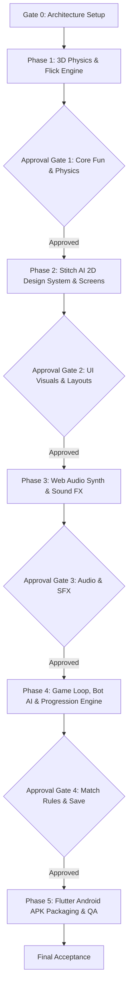

# 🎯 Production Development Plan: Pen Fight — Desk Wars
**Project Sovereignty:** 100% Standalone Offline Game Repository (`D:\FInal`)  
**Game Title:** **Pen Fight: Desk Wars — The Last Bench Game**  
**Local Asset Root:** `assets/` (All 3D models, textures, rooms, audio 100% self-contained)  
**Active Development Master:** `MASTER_DEVELOPMENT_PLAN.md` & `STITCH_AI_MASTER_PROMPT.md` (Project Root)  

---

## 🛑 Strict Governance & Iron Sovereignty Rules

1. **Rule 1 (Sole Master Driver & Roadmap):**
   - Root plan hi poora roadmap chalayega (`MASTER_DEVELOPMENT_PLAN.MD` aur `STITCH_AI_MASTER_PROMPT.MD`).
   - Game architecture, 11 levels (Naya Khiladi ➔ Last Bench Legend), 6 authorized pens, 16 badges, 7 ranking tiers, aur Stitch 2D UI sirf aur sirf inhi root plans ke hisab se govern honge.
2. **Rule 2 (Silent Emergency Physics Reference Dictionary):**
   - `D:\PAnfight\CLEAN_ROOM_SPECIFICATION.MD` sirf ek silent physics reference dictionary (help desk) ki tarah background me rahega.
   - Agar kisi physics formula, Center of Mass (COM), friction constant, ya math equation me AI kahin phanse, toh wahan se help li ja sakti hai.
   - Par uska koi level, student/opponent name (e.g. Bunty/9A), ya roadmap root game me execute nahi hoga. Help lene par AI chat me explicitly formula declare karega.
3. **Rule 3 (100% Standalone Repository Sovereignty):**
   - Game ka 100% saara data, assets, code, audio, textures, physics aur documentation isi project folder (`D:\FInal`) me local rahega.
   - Root codebase me koi external import ya direct path dependency nahi hogi, taaki GitHub par push karne par yeh repository bina kisi external directory ke 100% complete aur playable rahe.
4. **Rule 4 (Step-by-Step Approval & Gate Execution):**
   - **Step-by-Step Approval:** Har ek single step complete hone ke baad AI document me us step ko `[x] COMPLETED` mark karega, live proof/receipt chat me batayega, aur User se explicitly approval mangega: *"Step X complete ho gaya hai. Kya agle step ke liye APPROVED hai?"* User ke explicitly bole bina agla step shuru **NAHI** hoga.
   - **Phase Gate Approval:** Poora Phase khatam hone par Approval Gate ka comprehensive test pass hoga aur User se final Phase Approval lena mandatory hoga.
5. **Zero Unsolicited Deviation:**
   - AI apne man se koi library, formula, pen count, ya UI structure change/skip nahi karega.
6. **No 44-Pen / External Bloat (Strict 6 Pens & 11 Levels):**
   - Strict 6 pens: *Reynolds Trimax, Reynolds 045, Cello Butterflow, Pilot V5, Nataraj 621, Apsara Platinum*.
   - Strict 11 levels: *Naya Khiladi (0 XP) ➔ Last Bench Legend (3250 XP)*.
   - Strict 16 badges & 7 ranking tiers.
7. **Clean Layer Separation:**
   - **3D World (Three.js + Rapier):** Desk, Pens, Lighting, Physics Collisions, Flick mechanics.
   - **2D UI Layer (HTML/CSS via Stitch):** Top Scoreboard, Power Bar, Menus, Cards, Trophy Cabinet.

---

## 🎖️ Complete Level Ladder & Pen Inventory Specifications

### 📈 11 Levels & Progression (Kahan aur Kaise Banenge)
* **Kahan dikhega:** Player Profile aur dedicated **"Level Journey Ladder"** screen par (School merit list / classroom journey design).
* **Phases ka batwara:**
  * **Phase 2 (Visual UI - Step 2.3):** 11-step visual merit ladder screen banegi (har step tappable hoga, lock/unlocked status aur XP requirement dikhayega).
  * **Phase 4 (Logic & Storage - Step 4.3):** XP calculation engine, level-up trigger, aur `localStorage` save system implement hoga.
* **11 Levels List:**
  1. **Level 1 — Naya Khiladi:** 0 XP (Starting Tier)
  2. **Level 2 — Bench Beginner:** 100 XP
  3. **Level 3 — Pen Rookie:** 250 XP
  4. **Level 4 — Desk Challenger:** 450 XP
  5. **Level 5 — Flick Expert:** 700 XP
  6. **Level 6 — Class Champion:** 1000 XP
  7. **Level 7 — Pen Master:** 1350 XP
  8. **Level 8 — Desk Legend:** 1750 XP
  9. **Level 9 — School Star:** 2200 XP
  10. **Level 10 — Grand Champion:** 2700 XP
  11. **Level 11 — Last Bench Legend:** 3250 XP (Maximum / Grand Finale)

### 🖋️ 6 Authorized Pens & Tin Compass Box (Player Ko Apne Jeete Pen Kahan Dikhenge)
* **Kahan dikhega:** Player ko apne saare unlocked/jeete hue pens **"Tin Compass Box" (Pencil Geometry Box Screen)** ke andar 6 structured slots me dikhenge:
  * Box open hone par 6 pen cards aayenge (3D preview, Weight, Length, Friction, Accuracy stat bars, aur Special Trait).
  * Jo pen player jeet chuka hai wo unlocked aur **"Equip / Select"** karne ke liye ready rahegi.
* **Phases ka batwara:**
  * **Phase 1 (3D Mesh & Physics):** 6 Pens ki 3D geometry aur Rapier rigid-body physics (`js/pens.js`) — *Already Done*.
  * **Phase 2 (Visual UI - Step 2.3):** Nostalgic Tin Compass Box Screen aur Pen selection cards ka UI layout.
  * **Phase 4 (Logic & Dynamic Swapping - Step 4.3):** Pen unlock progression (Levels jeet kar pen unlock hona) aur selected pen ka live 3D table par spawn hona.
* **6 Pens List & Traits:**
  1. **Reynolds 045:** Classic transparent ballpoint (Default Unlocked - Balanced).
  2. **Cello Butterflow:** Smooth glider with rubber grip (Level 3 Unlock - Low Friction).
  3. **Pilot V5:** Needle-point precision pen (Level 5 Unlock - Fast Sharp Cut).
  4. **Nataraj 621:** Classic red-black wooden hexagonal pencil (Level 7 Unlock - Long Lever Arm).
  5. **Apsara Platinum:** Extra dark dense hexagonal pencil (Level 9 Unlock - High Mass Balance).
  6. **Reynolds Trimax:** Heavy triangular tank (Level 11 Grand Prize - Anti-Roll Desk Champion).

---

## 📊 Current Execution Status & Phase Health (Zameeni Haqeeqat)

Pehle external references ke confusion ki wajah se phases strictly serial order me execute nahi hue the aur kai hisse adhe chhut gaye the. Yeh raha har phase ka unvarnished audit ledger:

| Phase | Naam | Current Status | Kya Ho Chuka Hai (Done) | Kya Adha / Baki Hai (Pending Debt) |
| :--- | :--- | :--- | :--- | :--- |
| **Phase 1** | Core 3D Desk & Physics Engine | 🟢 **100% Complete** | Rapier 120Hz WASM physics, drag flick parabola ($\text{pull}^{1.45}$), 6 procedural 3D pens (`js/pens.js`), cel-shaded outlines, vertical desk ($0.70m \times 1.00m$), out-of-bounds drop settlement, 6-pen sandbox selector, pure decoupling | None (Ready for User Gate 1 Approval) |
| **Phase 2** | Stitch 2D UI & Nostalgia Screens | ⚪ **0% (Reset for Pure Sequencing)** | Reset to zero | Splash, Admission Form, Main Menu Hero screen, 11-Level Merit Ladder UI, Compass Box Pen Selector UI, 16-Badge Trophy Cabinet, Profile Report Card |
| **Phase 3** | Audio Synthesizer & SFX | ⚪ **0% (Reset to Zero)** | Reset to zero (Assets preserved in `assets/audio/`, execution halted until Gate 2 approval) | Step 3.1 synth, Step 3.2 SFX slotting, UI clicks, victory bell, level-up sound, chatter loop |
| **Phase 4** | Rules, Bot AI & Progression | ⚪ **0% (Reset to Zero)** | Reset to zero (Logic quarantined until Gate 3 approval) | Full 16 Badges ledger, 7 Ranking Tiers, 11 Levels progression, Dynamic pen swapping, Tournament rules |
| **Phase 5** | Flutter Android APK Packaging | ⚪ **0% (Not Started)** | None (Strict approval gate rule ke tehat intentionally untouched) | Flutter webview container, asset bundling, Android back button, release APK build |

---

## 🗺️ Master Phase Map & Approval Gates

---

## 📋 Phase-by-Phase Detailed Breakdown

### 🧱 Phase 1: Core 3D Desk, Pens & Rapier Physics Engine
*Goal: 1 single barebones page jisme desk par do pen flick ho sakein aur physics realistic feel de.*

> [!IMPORTANT]
> **Pen Design & 3D Geometry Division of Labor:**
> - **Three.js Code (Hamara Engine):** 6 Pens ki actual **3D Parametric Meshes** (Hexagonal body for Nataraj/Apsara, Cylindrical plastic for Trimax/045/Butterflow, Cone nib, metal clip, cap geometry) aur unke exact physics colliders hum Three.js + Rapier me procedural code se generate karenge (zero external 3D file bloat, 100% offline).
> - **Stitch AI (2D UI Cards):** Stitch in pens ke 2D presentation cards banayega (Pen selection menu, stat bars: Weight, Accuracy, Friction, Description, aur Pencil Box layout).

- [x] **Step 1.1 (COMPLETED):** Setup self-contained local web container (`index.html`, Three.js r160, `@dimforge/rapier3d-compat` WASM).
- [x] **Step 1.2 (COMPLETED):** Procedural Classroom Desk (`0.70m x 1.00m x 0.030m`) with wood finish and boundary colliders.
- [x] **Step 1.3 (COMPLETED):** 3D Pen Geometries for Player & Opponent:
  - Custom weight distribution: Cap/Tip Center of Mass (COM) offset.
  - Rapier RigidBody setup (Cylinder + Cone nib).
- [x] **Step 1.4 (COMPLETED):** Flick Drag Mechanics:
  - Backwards touch/drag gesture vector $\vec{D}$.
  - Force clamping + Off-center torque impulse $\vec{\tau} = \vec{r}_{\text{offset}} \times \vec{F}$.
- [x] **Step 1.5 (COMPLETED):** Desk Edge Teetering & Out-of-Bounds Detection:
  - Velocity rest threshold check ($\|\vec{v}\| < 0.015$, $\|\vec{\omega}\| < 0.08$).
  - Pen drops below $desk.y - 0.02m$ ➔ Fall detection and settlement timer.
- [x] **Step 1.6 (COMPLETED):** Pure Sequencing Quarantine & Reset to Zero:
  - Premature Phase 3 (audio hooks) aur Phase 4 (match loops, fake XP modals) ko Phase 1 ke core physics engine se cleanly decouple kar diya gaya.
  - Live 6-Pen sandbox selector HUD me integrate kiya gaya jisse user sabhi 6 pens (Reynolds 045, Trimax, Butterflow, Pilot V5, Nataraj 621, Apsara Platinum) ki physical bounciness aur roll resistance live test kar sake. Keyboard 'R' shortcut se instant reset enabled.
- 🎯 **APPROVAL GATE 1 (CURRENT VERIFICATION):** User runs and tests flicking on browser/mobile. "Kya pen ka slide, takkar aur kone par latakna real school pen-fight jaisa laga? Zero UI/audio bloat."

---

### 🎨 Phase 2: Stitch AI 2D UI & Nostalgia Visual System
*Goal: Desi Indian School Nostalgia UI layers banwana using tumhari existing images.*

- **Step 2.1:** Author `DESIGN.md` (Design tokens: Blackboard Green `#183B32`, Notebook Cream `#F3E5C8`, Desk Wood `#70452E`, typography and card frames matching nostalgic 90s school themes).
- **Step 2.2:** Batch A Prompt (Core Flow):
  - Splash screen + First Launch onboarding.
  - Main Menu (using `hero.png`).
- **Step 2.3:** Batch B Prompt (Identity & Collection):
  - Player Profile & Level Ladder (11 levels).
  - Pen Collection (using `tin-closed.png` / `tin-open-seven.png` compass box open animation).
- **Step 2.4:** Batch C Prompt (HUD & Gameplay Overlays):
  - Transparent in-game HUD (Scoreboard, turn indicator, power meter).
  - Pause menu + Match Win/Loss result (using `hero-championship-certificate.png` & `pen-fight-champion.png`).
- **Step 2.5:** Batch D Prompt (Cabinet & Settings):
  - 16-Badge Trophy Cabinet (using `penfight-trophy.png` & `penfight-belt-640.png`).
  - Ranking details (7 tiers: Beginner ➔ Legend) + Offline Settings.
- 🎯 **APPROVAL GATE 2:** All 11 screens visually inspected. "Kya theme 90s classroom jaisi hai aur HUD transparent Three.js canvas ke sath match kar raha hai?"

---

### 🔊 Phase 3: Audio Synthesis & Sound Effects
*(Current Status: ⚪ Reset to 0% — Execution halted until Phase 1 & 2 pass Approval Gates)*
*Goal: Zero-latency tactile feedback without broken remote URLs.*

- **Step 3.1:** 20-line standalone Web Audio API synthesizer for instant mechanical audio:
  - `synth_flick()` (Air whoosh pop)
  - `synth_clack()` (Crisp high-frequency plastic impact)
  - `synth_thud()` (Low-frequency wood desk hit)
- **Step 3.2:** Local assets slotting for the 10 core sounds (`assets/audio/`):
  - `sfx_flick.mp3`, `sfx_pen_hit_pen.mp3`, `sfx_pen_desk_slide.mp3`, `sfx_pen_fall.mp3`, `sfx_ui_button.mp3`, `sfx_round_win.mp3`, `sfx_round_loss.mp3`, `sfx_match_win.mp3` (school bell), `sfx_level_up.mp3`, `sfx_badge_unlock.mp3`.
- **Step 3.3:** Sound manager with audio toggles & fallback if files fail to load.
- 🎯 **APPROVAL GATE 3:** Sound triggers verified during flick, collision, and button clicks.

---

### 🧠 Phase 4: Game Rules, PC Opponent & Local Persistence
*(Current Status: ⚪ Reset to 0% — Execution halted until Phase 3 passes Approval Gate)*
*Goal: Rule-based classmate AI, match flow, 11-level progression, and 16 badges.*

- **Step 4.1:** Match Loop State Machine:
  - Best of 5 rounds (First to 3 wins).
  - Replay on double-fall, turn pass on zero-fall.
- **Step 4.2:** Mathematical `PCOpponentController`:
  - Distance and angle calculation (Target: knock player pen off nearest desk edge).
  - Easy (higher error spread) & Normal (accurate aim) difficulty.
- **Step 4.3:** Local Persistence (`IndexedDB` / `localStorage`):
  - Profile (name, avatar, level, XP).
  - 16 Badges unlock conditions ledger.
  - Ranking points & 7 tiers tracker.
- 🎯 **APPROVAL GATE 4:** Full 3-round match played against PC. Results screen properly updates XP and badges without duplicates.

---

### 📱 Phase 5: Flutter Android APK Packaging & Delivery
*Goal: 60 FPS offline Android APK.*

- **Step 5.1:** Flutter project integration (`webview_flutter` container).
- **Step 5.2:** Bundle all WebGL, Rapier WASM, HTML, and assets in `assets/web/`.
- **Step 5.3:** Android back-button handling, full-screen immersive mode, and touch calibration.
- **Step 5.4:** Build Release APK (`flutter build apk --release`).
- 🎯 **APPROVAL GATE 5:** Final APK installed and verified on physical Android phone.
