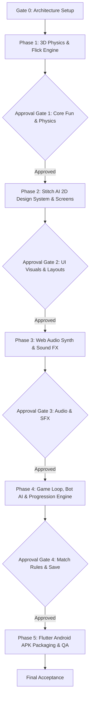

# 🎯 Production Development Plan: Pen Fight — Desk Wars
**Project Sovereignty:** Offline Android 3D Game (Flutter + Three.js + Rapier.js WASM + Stitch 2D HUD)  
**Game Title:** **Pen Fight: Desk Wars — The Last Bench Game**  
**Asset Anchor:** `D:\PAnfight\assets\Images`  
**Specification Anchor:** `D:\PAnfight\CLEAN_ROOM_SPECIFICATION.MD` (Physics-only reference)  
**Isolated External Reference:** `D:\penfight` *(Strictly read-only external benchmark: use only for verifying Center of Mass [COM] tuning and Bot aim trajectory formulas; zero code copy-paste or asset bleeding).*

---

## 🛑 Strict Governance & Anti-Skipping Protocol (Iron Rules)

1. **Gate-by-Gate Execution (Approval Gates):**
   - Agla phase tab tak shuru **NAHI** hoga jab tak pichla phase chalakar (browser/terminal/device me) test pass na ho jaye aur user explicitly **"APPROVED / NEXT"** na bole.
2. **Zero Unsolicited Deviation:**
   - AI apne man se koi library, formula, pen count, ya UI structure change/skip nahi karega.
   - Agar koi mechanical majboori aaye, toh pehle User se poochha jayega: **"Kyun kiya aur kahe kar rahe hain?"**
3. **No 44-Pen / External Bloat:**
   - Strict 6 pens: *Reynolds Trimax, Reynolds 045, Cello Butterflow, Pilot V5, Nataraj 621, Apsara Platinum*.
   - Strict 11 levels (Naya Khiladi ➔ Last Bench Legend).
   - Strict 16 badges & 7 ranking tiers.
4. **Clean Layer Separation:**
   - **3D World (Three.js + Rapier):** Desk, Pens, Lighting, Physics Collisions, Flick mechanics.
   - **2D UI Layer (HTML/CSS via Stitch):** Top Scoreboard, Power Bar, Menus, Cards, Trophy Cabinet.

---

## 🗺️ Master Phase Map & Approval Gates

---

## 📋 Phase-by-Phase Detailed Breakdown

### 🧱 Phase 1: Core 3D Desk, Pens & Rapier Physics Engine
*Goal: 1 single barebones page jisme desk par do pen flick ho sakein aur physics realistic feel de.*

> [!IMPORTANT]
> **Pen Design & 3D Geometry Division of Labor:**
> - **Three.js Code (Hamara Engine):** 6 Pens ki actual **3D Parametric Meshes** (Hexagonal body for Nataraj/Apsara, Cylindrical plastic for Trimax/045/Butterflow, Cone nib, metal clip, cap geometry) aur unke exact physics colliders hum Three.js + Rapier me procedural code se generate karenge (zero external 3D file bloat, 100% offline).
> - **Stitch AI (2D UI Cards):** Stitch in pens ke 2D presentation cards banayega (Pen selection menu, stat bars: Weight, Accuracy, Friction, Description, aur Pencil Box layout).

- **Step 1.1:** Setup self-contained local web container (`index.html`, Three.js r160, `@dimforge/rapier3d-compat` WASM).
- **Step 1.2:** Procedural Classroom Desk (`0.70m x 1.10m x 0.035m`) with wood finish and boundary colliders.
- **Step 1.3:** 3D Pen Geometries for Player & Opponent:
  - Custom weight distribution: Cap/Tip Center of Mass (COM) offset.
  - Rapier RigidBody setup (Cylinder + Cone nib).
- **Step 1.4:** Flick Drag Mechanics:
  - Backwards touch/drag gesture vector $\vec{D}$.
  - Force clamping + Off-center torque impulse $\vec{\tau} = \vec{r}_{\text{offset}} \times \vec{F}$.
- **Step 1.5:** Desk Edge Teetering & Out-of-Bounds Detection:
  - Velocity rest threshold check ($\|\vec{v}\| < 0.005$, $\|\vec{\omega}\| < 0.01$).
  - Pen drops below $desk.y - 0.02m$ ➔ Fall detection.
- 🎯 **APPROVAL GATE 1:** User runs and tests flicking on browser/mobile. "Kya pen ka slide, takkar aur kone par latakna real school pen-fight jaisa laga?"

---

### 🎨 Phase 2: Stitch AI 2D UI & Nostalgia Visual System
*Goal: Desi Indian School Nostalgia UI layers banwana using tumhari existing images.*

- **Step 2.1:** Author `DESIGN.md` (Design tokens: Blackboard Green `#183B32`, Notebook Cream `#F3E5C8`, Desk Wood `#70452E`, typography and card frames matching `D:\PAnfight\assets\Images`).
- **Step 2.2:** Batch A Prompt (Core Flow):
  - Splash screen + First Launch onboarding.
  - Main Menu (using `hero.png`).
- **Step 2.3:** Batch B Prompt (Identity & Collection):
  - Player Profile & Level Ladder (11 levels).
  - Pen Collection (using `tin-closed.png` / `tin-open-seven.png` compass box open animation).
- **Step 2.4:** Batch C Prompt (HUD & Gameplay Overlays):
  - Transparent in-game HUD (Scoreboard, turn indicator, power meter).
  - Pause menu + Match Win/Loss result (using `hero-championship-certificate.png` & `pen-fight-champion.png`).
- **Step 2.5:** Batch D Prompt (Cabinet & Settings):
  - 16-Badge Trophy Cabinet (using `penfight-trophy.png` & `penfight-belt-640.png`).
  - Ranking details (7 tiers: Beginner ➔ Legend) + Offline Settings.
- 🎯 **APPROVAL GATE 2:** All 11 screens visually inspected. "Kya theme 90s classroom jaisi hai aur HUD transparent Three.js canvas ke sath match kar raha hai?"

---

### 🔊 Phase 3: Audio Synthesis & Sound Effects
*Goal: Zero-latency tactile feedback without broken remote URLs.*

- **Step 3.1:** 20-line standalone Web Audio API synthesizer for instant mechanical audio:
  - `synth_flick()` (Air whoosh pop)
  - `synth_clack()` (Crisp high-frequency plastic impact)
  - `synth_thud()` (Low-frequency wood desk hit)
- **Step 3.2:** Pixabay CC0 local assets slotting for the 10 core sounds:
  - `sfx_flick.mp3`, `sfx_pen_hit_pen.mp3`, `sfx_pen_desk_slide.mp3`, `sfx_pen_fall.mp3`, `sfx_ui_button.mp3`, `sfx_round_win.mp3`, `sfx_round_loss.mp3`, `sfx_match_win.mp3` (school bell), `sfx_level_up.mp3`, `sfx_badge_unlock.mp3`.
- **Step 3.3:** Sound manager with audio toggles & fallback if files fail to load.
- 🎯 **APPROVAL GATE 3:** Sound triggers verified during flick, collision, and button clicks.

---

### 🧠 Phase 4: Game Rules, PC Opponent & Local Persistence
*Goal: Rule-based classmate AI, match flow, 11-level progression, and 16 badges.*

- **Step 4.1:** Match Loop State Machine:
  - Best of 5 rounds (First to 3 wins).
  - Replay on double-fall, turn pass on zero-fall.
- **Step 4.2:** Mathematical `PCOpponentController`:
  - Distance and angle calculation (Target: knock player pen off nearest desk edge).
  - Easy (higher error spread) & Normal (accurate aim) difficulty.
- **Step 4.3:** Local Persistence (`IndexedDB` / `localStorage`):
  - Profile (name, avatar, level, XP).
  - 16 Badges unlock conditions ledger.
  - Ranking points & 7 tiers tracker.
- 🎯 **APPROVAL GATE 4:** Full 3-round match played against PC. Results screen properly updates XP and badges without duplicates.

---

### 📱 Phase 5: Flutter Android APK Packaging & Delivery
*Goal: 60 FPS offline Android APK.*

- **Step 5.1:** Flutter project integration (`webview_flutter` container).
- **Step 5.2:** Bundle all WebGL, Rapier WASM, HTML, and assets in `assets/web/`.
- **Step 5.3:** Android back-button handling, full-screen immersive mode, and touch calibration.
- **Step 5.4:** Build Release APK (`flutter build apk --release`).
- 🎯 **APPROVAL GATE 5:** Final APK installed and verified on physical Android phone.
