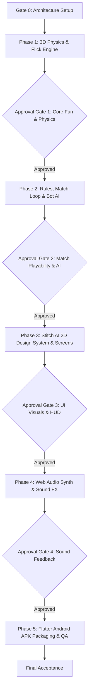

# 🎯 Production Development Plan: Pen Fight — Desk Wars
**Target Platform:** 100% Offline Android Mobile Game (Touch-First • Portrait 9:16 Layout • Flutter Container)  
**Project Sovereignty:** 100% Standalone Offline Game Repository (`D:\FInal`)  
**Game Title:** **Pen Fight: Desk Wars — The Last Bench Game**  
**Local Asset Root:** `assets/` (All 3D models, textures, rooms, audio 100% self-contained)  
**Active Development Master:** `MASTER_DEVELOPMENT_PLAN.md` & `STITCH_AI_MASTER_PROMPT.md` (Project Root)  

---

## 🛑 Strict Governance & Iron Sovereignty Rules

1. **Rule 1 (Sole Master Driver & Roadmap):**
   - Root plan hi poora roadmap chalayega (`MASTER_DEVELOPMENT_PLAN.MD` aur `STITCH_AI_MASTER_PROMPT.MD`).
   - Game architecture, 11 levels (Naya Khiladi ➔ Last Bench Legend), 6 authorized pens, 16 badges, 7 ranking tiers, aur Stitch 2D UI sirf aur sirf inhi root plans ke hisab se govern honge.
2. **Rule 2 (Silent Emergency Physics Reference Dictionary):**
   - `D:\PAnfight\CLEAN_ROOM_SPECIFICATION.MD` sirf ek silent physics reference dictionary (help desk) ki tarah background me rahega.
   - Agar kisi physics formula, Center of Mass (COM), friction constant, ya math equation me AI kahin phanse, toh wahan se help li ja sakti hai.
   - Par uska koi level, student/opponent name (e.g. Bunty/9A), ya roadmap root game me execute nahi hoga. Help lene par AI chat me explicitly formula declare karega.
3. **Rule 3 (100% Standalone Repository Sovereignty):**
   - Game ka 100% saara data, assets, code, audio, textures, physics aur documentation isi project folder (`D:\FInal`) me local rahega.
   - Root codebase me koi external import ya direct path dependency nahi hogi, taaki GitHub par push karne par yeh repository bina kisi external directory ke 100% complete aur playable rahe.
4. **Rule 4 (Step-by-Step Approval & Gate Execution):**
   - **Step-by-Step Approval:** Har ek single step complete hone ke baad AI document me us step ko `[x] COMPLETED` mark karega, live proof/receipt chat me batayega, aur User se explicitly approval mangega: *"Step X complete ho gaya hai. Kya agle step ke liye APPROVED hai?"* User ke explicitly bole bina agla step shuru **NAHI** hoga.
   - **Phase Gate Approval:** Poora Phase khatam hone par Approval Gate ka comprehensive test pass hoga aur User se final Phase Approval lena mandatory hoga.
5. **Zero Unsolicited Deviation:**
   - AI apne man se koi library, formula, pen count, ya UI structure change/skip nahi karega.
6. **No 44-Pen / External Bloat (Strict 6 Pens & 11 Levels):**
   - Strict 6 pens: *Reynolds Trimax, Reynolds 045, Cello Butterflow, Pilot V5, Nataraj 621, Apsara Platinum*.
   - Strict 11 levels: *Naya Khiladi (0 XP) ➔ Last Bench Legend (3250 XP)*.
   - Strict 16 badges & 7 ranking tiers.
7. **Clean Layer Separation:**
   - **3D World (Three.js + Rapier):** Desk, Pens, Lighting, Physics Collisions, Flick mechanics.
   - **2D UI Layer (HTML/CSS via Stitch):** Top Scoreboard, Power Bar, Menus, Cards, Trophy Cabinet.
8. **Rule 8 (Strict Mobile-First & Touch-First Architecture):**
   - Yeh game **100% Android Mobile Touchscreen (Portrait 9:16 / 9:20)** ke liye ban raha hai.
   - Koi bhi PC desktop pattern jaise physical keyboard shortcuts (`KeyR`), mouse hover effects (`:hover`), ya desktop-style horizontal bars game me nahi chalenge.
   - Saari UI elements, touch targets (minimum 48px), responsive safe areas, aur flick gestures sirf aur sirf Android mobile screen ko dhyan me rakh kar design aur build honge.
9. **Rule 9 (Phase 1 Engine Freeze & Strict Lock):**
   - **Phase 1 (Core 3D Physics & Rendering Engine) 100% Complete aur PERMANENTLY LOCKED hai.**
   - User Directive: *"Phase 1 ko lock kar do bina meri approval ke engine me koi change nahi hoga."*
   - Core files: `js/pens.js`, `js/desk.js`, Three.js scene setup, 120Hz Rapier WASM simulation loop, 6 parametric pen geometries, mass distribution, friction constants, table boundaries, aur drop detection strictly FROZEN hain.
   - Aage ke sabhi phases Phase 1 ko immutable (unalterable) base foundation maan kar chalenge. Bina explicit user approval ke engine files me koi bhi badlav karna strictly prohibited hai.
10. **Rule 10 (Official Google Play Store Policy & Architecture Compliance):**
   - Game ka koi bhi code, architecture ya asset Google Play Store ki official policies ke khilaf nahi jayega.
   - **Compliance Tools & Routing Boundaries:**
     - **`retrieving-developer-knowledge`:** Official Google Developer documentation se Target SDK API level 34/35 requirements, 64-bit ABI rules, aur Data Safety declarations fetch aur verify karne ke liye use hoga.
     - **`search_web`:** Google Play Developer Policy Center (`support.google.com/googleplay/android-developer`) se latest store policy updates (Families Policy, 20-tester requirement, zero data tracking policies) live verify karne ke liye use hoga.
     - **`android-cli`:** Android SDK platform tools, Gradle configurations (`minSdkVersion 24`, `targetSdkVersion 34/35`, NDK 64-bit ABI filters), aur local emulator/device testing ke liye use hoga.
   - **Data Safety Mandate:** Game 100% offline rahega (`localStorage` only). Zero analytics, zero unnecessary permissions (`INTERNET`, `CAMERA`, `STORAGE` etc. blocked from manifest), taaki Google Play Data Safety form 100% "No data collected, No data shared" rahe.
11. **Rule 11 (Phase 2 Logic & Rules Engine Freeze & Strict Lock):**
   - **Phase 2 (Rules, Match Loop, Bot AI, Progression & Storage) 100% Complete aur PERMANENTLY LOCKED hai.**
   - User Directive: *"Phase 2 ko bhi lock kar do bina meri approval ke koi change nahi hoga."*
   - Core logic files: `js/rules.js` (State machine & scoring), `js/bot.js` (Mathematical kinematics & difficulty tiers), `js/progression.js` (11 stages & 16 badges), aur `js/storage.js` (100% offline persistence) strictly FROZEN hain.
   - Phase 3 (Stitch UI) sirf inke exposed methods aur properties ko read/consume karega. Bina explicit user approval ke Phase 2 logic files me koi bhi change karna strictly prohibited hai.

---

## 🎖️ Complete Level Ladder & Pen Inventory Specifications

### 📈 11 Levels & Progression (Kahan aur Kaise Banenge)
* **Kahan dikhega:** Player Profile aur dedicated **"Level Journey Ladder"** screen par (School merit list / classroom journey design).
* **Phases ka batwara:**
  * **Phase 2 (Visual UI - Step 2.3):** 11-step visual merit ladder screen banegi (har step tappable hoga, lock/unlocked status aur XP requirement dikhayega).
  * **Phase 4 (Logic & Storage - Step 4.3):** XP calculation engine, level-up trigger, aur `localStorage` save system implement hoga.
* **11 Levels List:**
  1. **Level 1 — Naya Khiladi:** 0 XP (Starting Tier)
  2. **Level 2 — Bench Beginner:** 100 XP
  3. **Level 3 — Pen Rookie:** 250 XP
  4. **Level 4 — Desk Challenger:** 450 XP
  5. **Level 5 — Flick Expert:** 700 XP
  6. **Level 6 — Class Champion:** 1000 XP
  7. **Level 7 — Pen Master:** 1350 XP
  8. **Level 8 — Desk Legend:** 1750 XP
  9. **Level 9 — School Star:** 2200 XP
  10. **Level 10 — Grand Champion:** 2700 XP
  11. **Level 11 — Last Bench Legend:** 3250 XP (Maximum / Grand Finale)

### 🖋️ 6 Authorized Pens & Tin Compass Box (Player Ko Apne Jeete Pen Kahan Dikhenge)
* **Kahan dikhega:** Player ko apne saare unlocked/jeete hue pens **"Tin Compass Box" (Pencil Geometry Box Screen)** ke andar 6 structured slots me dikhenge:
  * Box open hone par 6 pen cards aayenge (3D preview, Weight, Length, Friction, Accuracy stat bars, aur Special Trait).
  * Jo pen player jeet chuka hai wo unlocked aur **"Equip / Select"** karne ke liye ready rahegi.
* **Phases ka batwara:**
  * **Phase 1 (3D Mesh & Physics):** 6 Pens ki 3D geometry aur Rapier rigid-body physics (`js/pens.js`) — *Already Done*.
  * **Phase 2 (Visual UI - Step 2.3):** Nostalgic Tin Compass Box Screen aur Pen selection cards ka UI layout.
  * **Phase 4 (Logic & Dynamic Swapping - Step 4.3):** Pen unlock progression (Levels jeet kar pen unlock hona) aur selected pen ka live 3D table par spawn hona.
* **6 Pens List & Traits:**
  1. **Reynolds 045:** Classic transparent ballpoint (Default Unlocked - Balanced).
  2. **Cello Butterflow:** Smooth glider with rubber grip (Level 3 Unlock - Low Friction).
  3. **Pilot V5:** Needle-point precision pen (Level 5 Unlock - Fast Sharp Cut).
  4. **Nataraj 621:** Classic red-black wooden hexagonal pencil (Level 7 Unlock - Long Lever Arm).
  5. **Apsara Platinum:** Extra dark dense hexagonal pencil (Level 9 Unlock - High Mass Balance).
  6. **Reynolds Trimax:** Heavy triangular tank (Level 11 Grand Prize - Anti-Roll Desk Champion).

---

## 📊 Current Execution Status & Phase Health (Zameeni Haqeeqat)

Pehle external references ke confusion ki wajah se phases strictly serial order me execute nahi hue the aur kai hisse adhe chhut gaye the. Yeh raha har phase ka unvarnished audit ledger:

| Phase | Naam | Current Status | Kya Ho Chuka Hai (Done) | Kya Adha / Baki Hai (Pending Debt) |
| :--- | :--- | :--- | :--- | :--- |
| **Phase 1** | Core 3D Desk & Physics Engine | 🔒 **100% Complete & LOCKED** | Rapier 120Hz WASM physics, drag flick parabola ($\text{pull}^{1.45}$), 6 procedural 3D pens (`js/pens.js`), cel-shaded outlines, vertical desk ($0.70m \times 1.00m$), out-of-bounds drop settlement, 6-pen sandbox selector, pure decoupling | **LOCKED BY USER (FROZEN):** Zero changes permitted to engine without explicit user approval. |
| **Phase 2** | Rules, Match Loop & Bot AI | 🔒 **100% Complete & LOCKED** | Step 2.1 (`js/rules.js`), Step 2.2 (`js/bot.js`), Step 2.3 (Pass & Play), Step 2.4 (`js/progression.js`), Step 2.5 (`js/storage.js`) complete & verified | **LOCKED BY USER (FROZEN):** Zero changes permitted under Rule 11 without explicit user approval. |
| **Phase 3** | Stitch 2D UI & Nostalgia Screens | 🟢 **100% (All 8 Screens Complete & Verified!)** | Step 3.1 (Tokens), Step 3.2 (Page 1 Splash/ID), Step 3.3 (Page 2 Main Menu Hub), Step 3.4 (Page 3 Campaign Map & Chit), Step 3.5 (Page 4 Tin Compass Box), Step 3.6 (Page 5 Match Setup), Step 3.7 (Page 6 Live HUD & Slingshot Gauge), Step 3.8 (Page 7 Match Result Certificate - 3 States), Step 3.9 (Page 8 Trophy Cabinet & Offline Settings - 3 States) ready & verified | • Steps 3.1-3.8 internal debt: Tailwind/Google Fonts local bundling for offline APK in Phase 5. |
| **Phase 4** | Audio Synthesizer & SFX | 🟡 **Ready / Step-by-Step** | Architecture & 1-by-1 Governance Approved (`PHASE_4_AUDIO_PLAN.md`) | Step 4.0 Foundation Engines, Steps 4.1-4.10 (3 options per sound ➔ user pick ➔ approval gate) |
| **Phase 5** | Google Play Compliant Android Packaging | ⚪ **0% (Not Started)** | None (Strict approval gate rule ke tehat intentionally untouched) | Step 5.1 Policy Pre-flight (`retrieving-developer-knowledge`), Step 5.2 Flutter Container, Step 5.3 Gradle 64-bit Setup (`android-cli`), Step 5.4 Families Compliance, Step 5.5 Production Release `.aab` |

---

## 🗺️ Master Phase Map & Approval Gates

---

## 📱 Mobile-First Sovereignty (Kahan AI Ne Web Ka Kaam Kiya Tha Aur Kahan Sudhaar Hoga)

Yeh game **100% Android Mobile Touchscreen (Portrait 9:16 Layout)** ke liye ban raha hai. Purani AI ne kahan-kahan desktop/web ke patterns inject kiye the, uska exact audit:

1. **PC Keyboard Shortcut (`js/main.js`):**
   * Physical keyboard listener `window.addEventListener('keydown', e => e.code === 'KeyR')` lagaya tha, jabki mobile device me physical keyboard nahi hota.
2. **Desktop HTML `<select>` Dropdowns (`index.html`):**
   * Top bar me standard browser desktop dropdowns lagaye the, jabki mobile UI me thumb-friendly touch cards ya bottom-sheets hoti hain.
3. **PC Landscape Camera Viewport (`js/main.js`):**
   * Camera calculation me `if (aspect >= 1.2)` (PC/Laptop widescreen) ko priority di gayi thi, jabki primary target mobile portrait vertical desk view hai.
4. **Horizontal Overcrowded Header (`index.html`):**
   * Top bar me 5-6 buttons aur controls ek hi line me horizontal flex the jo wide laptop screen ke hisab se the, vertical mobile screen par wo cut/squeeze hote hain.
5. **CSS `:hover` Pseudo-Classes (`index.html`):**
   * Desktop mouse hover states lagaye the jo mobile touch par sticky tap bug ban jate hain.

**Why WebGL/HTML was used:**
Architecture me Three.js + Rapier WASM ko Flutter Android container (`webview_flutter`) ke andar offline APK ke roop me package kiya ja raha hai (Phase 5). Lekin iska UI aur interaction **Desktop Web jaisa nahi, balki 100% Mobile Touch-First** hoga.

---

## 🧭 Feature-to-Phase Mapping (Easy/Normal/Hard & Scorecard Ka Asli Ghar)

Aapke dono sawalon ki poori clarity yeh hai ki yeh dono features kis-kis phase me aane the aur AI ne kahan confusion kiya:

### 1. 🎚️ Easy / Normal / Hard (Difficulty Toggle)
* **AI Logic & Kinematics (Engine me kahan chalega):** **Phase 2 (Step 2.2 — Mathematical PCOpponentController)**
  * *Easy:* High aim error spread ($\pm 16^\circ$), weak punch speed.
  * *Normal:* Realistic human error spread ($\pm 6.5^\circ$), balanced approach.
  * *Hard:* Sharp aim ($\pm 3^\circ$), high speed, aur 60% spin cut-shots.
* **Visual UI (Kahan dikhega):** **Phase 3 (Step 3.4 — Match Setup Screen)**
  * Stitch AI jab match setup screen banayega, wahan player friendly classmate card ke sath **Easy / Normal / Hard** chunega.
* **Phase 1 Resolution & Clean-up (Sahi Kiya Gaya):** Phase 1 ke sandbox se Easy/Norm/Hard buttons aur out-of-order difficulty logic ko 100% hata diya gaya hai. Phase 1 ab sirf pure 3D physics verification ke liye hai. Yeh feature apne nirdharit Phase 2 (Bot Kinematics) aur Phase 3 (UI Setup) me implement hoga.

### 2. 📋 Score Card (Scoreboard & Match Result)
* **Match Rules & Score Counting (State Machine):** **Phase 2 (Step 2.1 — Match Loop State Machine)**
  * Best of 5 format (first to 3 wins), double fall = re-flick, round won logic, aur result save.
* **Visual 2D HUD & Result Modal (Kahan dikhega):** **Phase 3 (Step 3.4 — HUD & Gameplay Overlays)**
  * Transparent top scoreboard (P1 avatar vs Opponent avatar, round indicators, selected pen names) aur Match Win/Loss certificate modal Stitch AI banayega.
* **Phase 1 Resolution & Clean-up (Sahi Kiya Gaya):** 3D blackboard aur HUD se Best-of-5 scoring, player/opponent KO counters, aur result modals ko 100% decouple aur remove kar diya gaya hai. Blackboard par ab sirf pure physics duel chalk info aati hai. Scoreboard ka poora visual card Phase 3 (Step 3.4) aur round-counting logic Phase 2 (Step 2.1) me banegi.

---

## 📋 Phase-by-Phase Detailed Breakdown

### 🧱 Phase 1: Core 3D Desk, Pens & Rapier Physics Engine
*Goal: 1 single barebones page jisme desk par do pen flick ho sakein aur physics realistic feel de.*

> [!IMPORTANT]
> **Pen Design & 3D Geometry Division of Labor:**
> - **Three.js Code (Hamara Engine):** 6 Pens ki actual **3D Parametric Meshes** (Hexagonal body for Nataraj/Apsara, Cylindrical plastic for Trimax/045/Butterflow, Cone nib, metal clip, cap geometry) aur unke exact physics colliders hum Three.js + Rapier me procedural code se generate karenge (zero external 3D file bloat, 100% offline).
> - **Stitch AI (2D UI Cards):** Stitch in pens ke 2D presentation cards banayega (Pen selection menu, stat bars: Weight, Accuracy, Friction, Description, aur Pencil Box layout).

- [x] **Step 1.1 (COMPLETED):** Setup self-contained local web container (`index.html`, Three.js r160, `@dimforge/rapier3d-compat` WASM).
- [x] **Step 1.2 (COMPLETED):** Procedural Classroom Desk (`0.70m x 1.00m x 0.030m`) with wood finish and boundary colliders.
- [x] **Step 1.3 (COMPLETED):** 3D Pen Geometries for Player & Opponent:
  - Custom weight distribution: Cap/Tip Center of Mass (COM) offset.
  - Rapier RigidBody setup (Cylinder + Cone nib).
- [x] **Step 1.4 (COMPLETED):** Flick Drag Mechanics:
  - Backwards touch/drag gesture vector $\vec{D}$.
  - Force clamping + Off-center torque impulse $\vec{\tau} = \vec{r}_{\text{offset}} \times \vec{F}$.
- [x] **Step 1.5 (COMPLETED):** Desk Edge Teetering & Out-of-Bounds Detection:
  - Velocity rest threshold check ($\|\vec{v}\| < 0.015$, $\|\vec{\omega}\| < 0.08$).
  - Pen drops below $desk.y - 0.02m$ ➔ Fall detection and settlement timer.
- [x] **Step 1.6 (COMPLETED):** Pure Sequencing Quarantine & Reset to Zero:
  - Premature Phase 3 (audio hooks) aur Phase 4 (match loops, fake XP modals) ko Phase 1 ke core physics engine se cleanly decouple kar diya gaya.
  - Live 6-Pen sandbox selector HUD me integrate kiya gaya jisse user sabhi 6 pens (Reynolds 045, Trimax, Butterflow, Pilot V5, Nataraj 621, Apsara Platinum) ki physical bounciness aur roll resistance live test kar sake. Keyboard 'R' shortcut se instant reset enabled.
- [x] 🎯 **APPROVAL GATE 1 (LOCKED & FROZEN BY USER):** Phase 1 Core 3D Physics Engine has been verified and permanently locked. User Directive: *"Phase 1 ko lock kar do bina meri approval ke engine me koi change nahi hoga."* Core files (`js/pens.js`, `js/desk.js`, Rapier physics world) are frozen. Zero edits permitted without explicit user instruction.

---

### 🧠 Phase 2: Rules, Match Loop & Bot AI 🔒 (100% COMPLETE & LOCKED)
*(Current Status: 🔒 100% Complete & Permanently Frozen under Rule 11)*
*Goal: Turn system, Best-of-5 scoring, 3-tier mathematical Bot AI, 2-player Pass & Play, aur offline local persistence.*

> [!CAUTION]
> **RULE 11 ENFORCEMENT — PHASE 2 ENGINE FREEZE:**
> Phase 2 ke sabhi 4 core modules (`js/rules.js`, `js/bot.js`, `js/progression.js`, `js/storage.js`) 100% complete aur verified hain. User Directive: *"Phase 2 ko bhi lock kar do bina meri approval ke engine me koi change nahi hoga."*
> Phase 3 (UI) sirf inke methods ko read/consume karega. In files me koi bhi manual edit strictly PROHIBITED hai.

- [x] **Step 2.1 (COMPLETED): Match Loop & Turn State Machine (`js/rules.js`):**
  - **Turn Flow:** `P1_AIMING` ➔ `SIMULATING` ➔ `SETTLING` ($\|\vec{v}\| < 0.015\text{ m/s}$, $\|\vec{\omega}\| < 0.08\text{ rad/s}$) ➔ `ROUND_OUTCOME` ➔ `NEXT_TURN / ROUND_RESET`.
  - **Failsafe Timeout:** 3.5s maximum simulation timer to prevent infinite spinning/rolling locks.
  - **Scoring Rules:** Best-of-5 format (first to 3 round wins). Point awarded on knocking opponent off table while staying safe. Simultaneous drop = Draw (Re-flick). Both stay on desk = Turn passes to opponent.
  - **Round Reset:** Re-centering pens to spawn duel positions ($Z: \pm0.35m$) smoothly without page reload.
  - *Verification Receipt:* Player aur Opponent बारी-बारी फ्लिक कर सकें, पॉइंट्स 3 तक सही गिने जाएँ, और ड्रा होने पर री-फ्लिक हो। Puppeteer automated tests passed (7/7 tests pass). Live scoreboard & blackboard announcements connected.

- [x] **Step 2.2 (COMPLETED): Mathematical `PCOpponentController` (`js/bot.js`):**
  - **Targeting Kinematics:** 3D Raycasting to player pen ($\vec{D} = \text{Pos}_{\text{player}} - \text{Pos}_{\text{bot}}$).
  - **3 Difficulty Tiers:**
    - *Easy Mode:* Angular spread error $\pm 16^\circ$ ($0.28\text{ rad}$), weak punch scaling ($0.15-0.40$), 0% spin cut-shots.
    - *Normal Mode:* Realistic human spread $\pm 6.5^\circ$ ($0.11\text{ rad}$), balanced punch ($0.45-0.75$), 20% spin cut-shots.
    - *Hard Mode:* Razor aim $\pm 3^\circ$ ($0.05\text{ rad}$), aggressive punch ($0.85-1.25$), 60% spin cut-shots.
  - **Human Pacing:** 0.8s contemplation pause before bot flicks.
  - **Start-of-Round Safety Invariant:** Runway $> 0.42\text{m}$ par bot impulse clamp taaki turn-1 par instant KO na ho sake.
  - **Dynamic Tester Toggle:** Sandbox HUD me Easy/Normal/Hard selector (`#diff-select`).
  - *Verification Receipt:* Puppeteer automated tests passed (7/7 tests pass). AI presets, difficulty switching, impulse bounds, aur UI sync 100% verified.

- [x] **Step 2.3 (COMPLETED): Local 2-Player "Pass & Play" Engine:**
  - **1-Phone Dual Duel:** Ek hi phone par bina internet do dost aamne-saamne baithkar duel khel sakein.
  - **Dual Input Handling:** Player 1 (Bottom/South side) flick; Player 2 (Top/North side) 180° inverted flick. Unified `executeFlick(side, dirX, dirZ, dragPx)`.
  - **Strict Input Lock:** Jis player ki baari hai, sirf usi ki pen touch/drag accept karegi; doosre player ki pen lock rahegi (`isInteractionAllowed(side)`).
  - **Mode Selector:** Sandbox me "VS Bot" ↔ "Pass & Play (2P)" live dropdown selector (`#mode-select`).
  - *Verification Receipt:* Puppeteer automated tests passed (7/7 tests pass). 2P mode toggle, dynamic `#diff-select` visibility, strict input locks per player, turn badges, aur mobile UI layout verified via screenshot receipt.

- [x] **Step 2.4 (COMPLETED): 11-Level Progression & 16 Badges Ledger (`js/progression.js`):**
  - **XP Kinematics:** Base Win = `+50 XP`, Clean Sweep (3-0) bonus = `+75 XP`, Difficulty bonus (`+15/+30 XP`), Match Loss = `+15 XP` (Consolation).
  - **Class & Sub-section Campaign Hierarchy:**
    - *Tier 1: Class 7-A (Home Class)* ➔ Stage 1: Last Bench Duel (Easy), Stage 2: Middle Row Rival (Normal), Stage 3: Section 7-A Monitor (Hard Boss).
    - *Tier 2: Inter-Section Knockouts (Class 7-B & 7-C)* ➔ Stage 4: 7-B Lunch Break Challenger, Stage 5: 7-C Specialist, Stage 6: Class 7 Overall Champion.
    - *Tier 3: The Seniors Duel (Class 8-A, 8-B, 8-C)* ➔ Stage 7: 8-A Frontbencher, Stage 8: 8-B Backbencher Gang, Stage 9: 8-C Heavy Trimax King.
    - *Tier 4: School Grand Finale* ➔ Stage 10: Staff Room Corridor Cup, Stage 11: School Championship Final.
  - **11 Progression Levels:** $0 \rightarrow 4300$ XP (*Naya Admission* se *School Pen Fight Legend* tak).
  - **16 Badges Evaluator:** Pure criteria evaluators (*First Blood*, *Clean Sweep*, *Comeback Hero*, *Edge Survivor*, *Hard Champion*, *Heavy Knockout*, *Iron Defense*, *Monitor Dethroned*, *Intersection Hero*, *Senior Slayer*, *School Legend*, *Cut-Shot Master*, *Rapid Duel*, *5 Win Streak*, *2-Player Dost*, *Compass Box Master*).
  - *Verification Receipt:* Puppeteer automated tests passed (8/8 tests pass). XP calculation, clean sweep bonus, level promotion, badge unlock triggers, 11 stages hierarchy, aur full state serialization verified.

- [x] **Step 2.5 (COMPLETED): Offline LocalStorage Persistence & State Hydration (`js/storage.js`):**
  - **Clean Schema:** `penfight_save_v2` (profile, progression [XP, stage, stats, badges, pensUsed], unlockedPens, settings). 100% offline (Google Play Families Data Safety compliant).
  - **Two-way Hydration:** Game boot par memory me load ho, selected pens/mode/difficulty hydrate hon, match khatam hone par auto-save ho.
  - **Safety & Reset:** Corrupt data recovery fallback aur development reset method (`clearCareerData()`).
  - *Verification Receipt:* Puppeteer automated tests passed (8/8 tests pass). Settings & pen auto-save, full page refresh hydration test, corrupt JSON graceful fallback, aur `clearCareerData()` reset verified.

- 🎯 [x] **APPROVAL GATE 2 (PASSED & LOCKED 🔒):** Best-of-5 scoring, 3-tier bot kinematics, 2-player mode, 11-level progression, 16 badges, aur offline local persistence 100% verified and permanently frozen under Rule 11.

---

### 🎨 Phase 3: Stitch AI 2D UI & Arcade "Juicy" Nostalgia System
*(Current Status: 🟡 Ready to Start — Step 3.1 Next)*
*Goal: 90s Indian Classroom Nostalgia ko high-energy, tactile, juicy arcade aesthetics (Chunky 3D Buttons, 2.5px Text Outlines, Color-Shifting Slingshot, Spring Banners, Collectible Pen Finishes) ke sath Stitch AI se generate aur implement karna.*

> [!IMPORTANT]
> **The Hybrid Fusion Architectural Invariant (School Nostalgia + Arcade Juice):**
> 1. **Core Theme & Soul (Unchanged):** 100% Authentic Indian School Pen Fight (Class 7-A, Reynolds 045, Trimax, Nataraj 621, Butterflow, Pilot V5, Apsara, Steel Geometry Box, Ruled Chits, Blackboard, Teacher Red Ink Ticks).
> 2. **Arcade Juice & Tactile Touch Feel:**
>    - **Arcade Typography:** Bold `Fredoka Heavy` / `Titan One` with solid 2.5px dark stroke (`-webkit-text-stroke: 2.5px #111`) aur deep drop-shadow for 100% legibility over 3D wooden desk.
>    - **Tactile 3D Push Buttons:** Chunky 3px dark border, solid 6px base depth (`box-shadow: 0 6px 0 #b45309`), rounded 16px corners, instant 4px downward press on touch (`transform: translateY(4px); box-shadow: 0 2px 0 #b45309;`) with zero tap delay (`touch-action: manipulation;`).
>    - **Floating Spring Banners:** Elastic spring entrance (`cubic-bezier(0.175, 0.885, 0.32, 1.275)` scale bounce: 0.4 ➔ 1.15 ➔ 1.0) for *"YOUR TURN!"*, *"ROUND WON!"*, *"OUT OF DESK!"*, *"KNOCKOUT!"*.
>    - **Color-Shifting Slingshot Trajectory Arc:** Dynamic drag power feedback: 0-40% Neon Green (`#22c55e`), 41-75% Amber Gold (`#f59e0b`), 76-100% Explosive Crimson (`#ef4444`) with subtle pulse.
>    - **Collectible Toy Pen Finishes:** 3D pen visual finishes upgraded to high-contrast collectible toy aesthetic (Trimax translucent blue glowing chamber & chrome clips, 045 milky white body & punchy blue cap, Butterflow glossy two-tone, Pilot V5 charcoal & gold foil rings, Nataraj red-black stripes, Apsara matte black & green eraser). *Strict Rule 9 Invariant: Physics colliders, mass, and damping remain 100% FROZEN; only visual Three.js PBR materials are enhanced.*
> 3. **Performance & Offline Mandate:** 100% GPU-composited animations (`transform: translate3d()` & `opacity`), zero layout jank, 100% self-contained local fonts & assets (zero external CDN).

> [!NOTE]
> **Human-in-the-Loop Stitch Workflow Protocol (User-AI Collaborative Pipeline):**
> Phase 3 ke har step (Step 3.1 se 3.9) me following 4-step collaborative process lagu hoga:
> 1. **Prompt Delivery by AI:** AI pehle us specific screen ke liye production-ready, design-token mapped **Stitch AI Master Prompt** generate karke user ko chat me dega.
> 2. **Design Generation by User:** User us prompt ko Stitch AI platform me enter karke desired juicy arcade nostalgia layout aur visual assets generate/select karega.
> 3. **UI Integration by AI:** User ke code/assets share karne aur approval dene ke baad hi AI use game ke UI layer me wire karega.
> 4. **Step-by-Step Mobile Verification:** Har screen ko 360x800 portrait viewport par test karke user se explicit approval lene ke baad hi agli screen ka prompt diya jayega.

- [x] **Step 3.1 (COMPLETED): Arcade Design Tokens & Foundations (`DESIGN.md` + Base CSS):**
  - **Foundation Ready:** `D:\FInal\DESIGN.md` (Design system documentation) aur `D:\FInal\css\base.css` (CSS Custom properties, 3D button depths, text strokes, container cards, spring keyframes) create karke `index.html` me link kar diye gaye hain taaki Stitch AI ko feed karke saari upcoming screens (3.2 se 3.9) ek hi consistent theme me generate karwayi ja sakein.
  - *Verification Receipt:* 90s Classroom + Juicy Arcade palette, `.btn-arcade-3d` tactile push classes, text stroke rules, aur slingshot force tokens 100% defined and offline ready.
  - 🚨 **Pending Debt / Future Connectors (Step 3.1):**
    - `Tailwind CDN Localisation`: `index.html` me abhi `https://cdn.tailwindcss.com` external script chal raha hai. Google Play Families 100% offline rule ke hisaab se use local CSS bundle me replace karna pending hai.
    - `Offline Fonts Packaging`: Online Google Fonts (`Permanent Marker`, `Patrick Hand`, `Caveat`, `Nunito Sans`) ko `assets/fonts/` me WOFF2/TTF locally serve karna pending hai.

- [x] **Step 3.2 (COMPLETED): Splash Screen & School ID Card (Collectible Onboarding):**
  - **Implementation:** Stitch AI se design fetch karke `index.html`, `css/splash.css`, aur local asset `assets/student_avatar.jpg` me wire kiya gaya. Authentic 90s torn notebook chit, Saraswati Vidyalaya pass, Roll #14, Class 7th-B, Khiladi ka Naam input, Reynolds 045 Fine primary stats, aur tactile 3D `[ENTER CLASSROOM ➔]` button integrated.
  - *Verification Receipt:* Mobile viewport (390x844) live verified via Puppeteer. Name input syncs directly with `StorageManager` (`localStorage.penfight_save_v2`), Enter button tap par smooth 0.4s exit transition ke sath arena reveal hota hai. Commit: `e229b64`.
  - 🚨 **Pending Debt / Future Connectors (Step 3.2):**
    - `Arsenal Pen Switching on Page 1`: Primary weapon `Reynolds 045 Fine - 0.5mm Tip` abhi static text hai; Step 3.5 (Compass Box) banne ke baad unlocked pens (jaise Nataraj 621) ko direct switch karne ka selection hook pending hai.
    - `Mobile Camera Capture API`: Avatar photo upload abhi file picker use karta hai; native device camera se instant photo click karne ka Android intent hook Phase 5 me aayega.

- [x] **Step 3.3 (COMPLETED): Main Menu Home Screen (The Classroom Arcade Hub):**
  - **Implementation:** Stitch AI se user ka banaya hua *Main Menu Home Screen (Pencil Sketch CTA)* fetch karke `index.html`, `css/menu.css`, aur local asset `assets/desk_duel_arena.jpg` me wire kiya gaya. Notebook Page 02 layout, attested student profile, level/XP progress bar, center wooden desk photo stage (Reynolds 045 vs Cello Gripper with neon trajectory arc), tactile `[⚡ TOSS + PLAY ➔]` pencil sketch CTA, aur 4 retro mode cards (Story Mode, Pass & Play, Compass Box, Trophy Rack) integrated.
  - *Verification Receipt:* Mobile viewport (390x844) live verified via Puppeteer. Splash screen se smoothly transition hokar Main Menu khulta hai, `⚡ TOSS + PLAY` ya `FIGHT` dabane par bot match start hota hai, `TOSS ⇄` dabane par 2-Player Pass & Play mode activate hota hai, aur HUD me `🏫 Menu` button se wapas Main Menu par aaya ja sakta hai. Commit: `cc2c6d3`.
  - 🚨 **Pending Debt / Future Connectors (Step 3.3):**
    - `Compass Box & Trophy Rack Placeholder Alerts`: Compass Box aur Trophy Rack mode cards par abhi placeholder alerts aate hain; inka actual screens (Step 3.5 & Step 3.9) se hook-up pending hai.
    - `Table Duel 3D Preview Stage`: Center stage abhi static image (`desk_duel_arena.jpg`) hai; actual live Three.js viewport mini-render Step 3.7 ke sath integrate hona pending hai.
    - `Settings Drawer Hook`: Top header gear button `⚙️` abhi alert dialog deta hai; Step 3.9 ke offline audio/SFX settings drawer se hook-up pending hai.

- [x] **Step 3.4 (COMPLETED): Visual Campaign Map & Stage Details Chit (Class 7 ➔ Class 8):**
  - **Implementation:** Stitch AI Screen `4c5110bfc5ba48e499bfe56e02187162` se Notebook Page 03 layout fetch karke `index.html`, `css/campaign.css`, aur 11 unique opponent caricatures (`assets/opponents/stage_01.jpg` to `stage_11.jpg`) me wire kiya gaya.
  - **Core Features Implemented:**
    - Notebook Page 03 header with Saraswati Vidyalaya branding, Page No & Date index, aur live Bench Progress count (`🏫 04/11 Cleared`).
    - 11-Desk promotion track (`X/11 Desks Cleared`, dynamic star sum `X/33 Stars ⭐`, pencil progress bar).
    - Cleared desks: Green checkmark badge `✔️`, actual earned star count (1★, 2★, 3★ from `stageStars`), and `Replay Recess?` match launcher.
    - Active Challenge: Authentic **Yellow Lined Revision Chit (`yellow-chit-hatch`)** with paperclip, pushpin 📌, opponent sketch caricature, weapon badge, Flick Force & Bench Grip bars, bench rule, rewards, aur `⚔️ FIGHT! ➔` / `🔄 WARMUP` buttons.
    - Next locked stage: Dashed border with lock icon `🔒` and `PERIOD X LOCK` tag.
    - Mid-campaign Boss 1 gateway preview (Stage 06 Vikram Topper / Maths Sir Desk).
    - Floating Recess Bell Timer with live countdown (`03:45 mins left`) and 00:00 non-blocking period bell alert toast.
    - Dynamic Teacher's Stamp (`NEW ADMISSION` ➔ `PASSED STG 0X` ➔ `CHAMPION 1998`).
  - *Verification Receipt:* Mobile viewport (390x844) live verified via Puppeteer. Story Mode entry from Menu, Stage match launch (`FIGHT! ➔`), Hub return (`← HUB`), dynamic stars rendering, aur recess timer reset verified. Commits: `ec15e65` & `9046db1`.
  - 🚨 **Pending Debt / Future Connectors (Step 3.4):**
    - `Match Outcome Reward Credit`: Match jeetne ke baad reward (+₹300 Coins, Refills, Star) player wallet me credit hona Step 3.8 (Match Outcome Certificate) ke completion par depend karta hai.
    - `Dynamic Star Overwrite on Replay`: Purane stage ko replay karke behtar score karne par save file me star upgrade Step 3.8 se sync hoga.
    - `Locked Period Chit Modal`: Locked desks par click karne par specific unlock requirement popup card dikhana pending hai.

- [x] **Step 3.5 (COMPLETED): Tin Compass Box Screen (Collectible Pen Showcase):**
  - **Implementation:** Stitch Screen `99b1a1d0c65049f49f2f0614a6efec13` ("Tin Compass Box - Geometry Box Arsenal") ko `index.html`, `css/compass.css`, aur 6 local pen macro assets (`reynolds_slot.jpg`, `nataraj_slot.jpg`, `gripper_slot.jpg`, `pen_extra.jpg`, `trimax_slot.jpg`, `apsara_slot.jpg`) ke sath wire kiya gaya.
    - Camlin Tin Geometry Box embossed tray with 6 slots (Reynolds 045, Nataraj 621, Cello Butterflow, Pilot V5, Reynolds Trimax, Apsara Platinum).
    - Unlocked vs locked visual states (`STG 3`, `STG 5`, `STG 8`, `STG 10` badges & grayscale lock filters).
    - Inspection Report card with pen macro photo, tape sticker mod (`Mod: Double Rubber Band + M-Seal Cap Weight`), pen type, exact weight, and handwriting lore quote.
    - 4 real-time stat bars (Knockout Mass, Agility/Spin, Roll Drag friction, Tip Nib Precision).
    - Chunky tactile hatched button (`[EQUIP PEN ->]` / `[EQUIPPED & READY TO FLICK]`) that switches player pen in `localStorage` and 3D physics scene (`gameEngine.changePen('player', penKey)`), updates Main Menu badge (`#menu-player-pen-label`), and updates slots in real time.
    - Classroom Mod desk alert dialog for rubber grip tape, M-seal counterweight, and sharpened nib tips.
  - *Verification Receipt:* Mobile viewport (390x844) live verified via Puppeteer. Equipping Nataraj 621 updates save state (`selectedPlayerPen: 'nataraj621'`), reflects on Main Menu hub badge (`NATARAJ 621`), and slots dynamically update. Screenshots: `compass_box_live.png`, `compass_box_nataraj_selected.png`, `compass_box_nataraj_equipped.png`.
  - 🚨 **Pending Debt / Future Connectors (Step 3.5):**
    - `Mod Customizer Workshop`: Future update me actual stat modifiers apply karne ke liye visual upgrade workbench.
    - `Unlock Animation Fanfare`: Campaign stage clear hone par newly unlocked pen ka geometry box opening animation Step 3.8 ke reward flow se trigger hoga.

- [x] **Step 3.6 (COMPLETED): Match Setup Screen (Single Player & Pass-and-Play Cards):**
  - **Implementation:** Stitch Screen `0876780d14b04991b1414caa8664fb98` ("Match Setup - Desk Duel") ko `index.html`, `css/match_setup.css`, aur local pen/opponent assets ke sath wire kiya gaya.
    - Two-tab tactile mode switcher (`Single Player` vs `Pass & Play`) with hatched 3D arcade buttons.
    - Single Player Mode: Pinned yellow revision ID slip with paperclip, red pushpin, opponent caricature photo (`assets/opponents/stage_06.jpg`), `ROLL #09`, House tag, rival weapon label, `DESK RIVAL ATTESTED` red rubber stamp, speech bubble quote, and 3 tactile difficulty pills (`1st Bencher` / `Desk Regular` / `Monitor`) connecting to `gameEngine.setBotDifficulty()`.
    - Pass & Play Mode: 1 Phone • 2 Khiladi turn-based dual pen selector with center `VS` red chalk seal. Blue Corner (P1) and Red Corner (P2) interactive pen cards with macro photo, agility/mass stats, and click-to-cycle pen mechanism (`window.cyclePassPlayPen()`).
    - Match Launch Flow: Single player button `[START DUEL ⚔️]` and pass-and-play button `[START PASS & PLAY ⚔️]` seamlessly dismiss overlay, configure `gameEngine` mode, and start the round.
  - *Verification Receipt:* Mobile viewport (390x844) live verified via Puppeteer. Single Player difficulty selection, Pass & Play dual pen cycling, and match launch transition verified. Screenshots: `match_setup_single_player_live.png`, `match_setup_passplay_fixed.png`.
  - 🚨 **Pending Debt / Future Connectors (Step 3.6):**
    - `Coin Toss Interactive Flip Animation`: Pass & Play mode me actual coin flipping 3D/2D animation Step 3.7 ke HUD animation loop me polish hoga.
    - `Custom Rival Caricature Mapping`: Quick duel me random student caricatures ya high-tier bosses ka dynamic selection.

- [x] **Step 3.7 (COMPLETED): In-Game Transparent HUD & Color-Shifting Slingshot:**
  - **Implementation:** Stitch AI Screen `d0279f0a85b14ef5a16905f61c9de372` ("Live 3D Arena - Slingshot HUD") aur Screen `11ef3533d85340e7a7704e58a6ed52a6` ("Pause Drawer - Recess Timeout Chit") ko `index.html`, `css/hud.css`, aur decoupled controller `js/hud.js` me merge karke `js/main.js` ke physics engine aur match setup se bind kiya gaya.
  - **Core Features Implemented:**
    - Transparent overlay (`#game-hud-overlay`) with `pointer-events: none` on backdrop and `pointer-events: auto` on interactive cards/buttons.
    - Top Status Header: Recess period pill, stake badge, live bounty chip, aur circular tactile 3D pause button.
    - Head-to-Head Scoreboard Card: Blue ruled notebook slip with red margin, red pushpin, P1 avatar/name/pen/roll, center `ROUND X / Y` timer + `VS` chip, aur P2 avatar/name/pen/roll with best-of-3 dynamic round pips (`round-pip-won`, `round-pip-pending`).
    - Torn Paper Spring Banner (`#hud-turn-banner`): `YOUR TURN! 🎯` / `OPPONENT AIMING... ⏳` / `KNOCKOUT! 💥` with rubber stamp badge (`OUT OF DESK ⚡`), non-blocking pointer passthrough during drag.
    - Environment Chips: Ceiling fan drift (`0.4 km/h West`) & desk grip indicator (`Teak Wood - High`).
    - Tactile Slingshot Power Meter Card: Dynamic progress bar with color shift (Green ➔ Amber ➔ Red), tension zone indicator (`BALANCED`, `SWEET REBOUND ZONE`, `ROCKET BLAST`), and live percentage badge.
    - Tactile Action Dock: Aim Lock toggle, deep navy `⚡ FLICK! RELEASE STRIKE ➔` hero CTA, peach Spin Grip stance toggle, and Rule #2 cautionary chit.
    - Recess Timeout Pause Modal (`#pause-menu-modal`): Ruled paper chit with paperclip, pushpin, PT Tiwari Sir alert, live score summary, SFX/Haptics toggles, `RESUME DUEL ⏱️`, `RESTART ROUND 🔄`, and `QUIT TO CLASSROOM HUB 🚪`.
    - Physics Loop Decoupling: Match paused state cleanly freezes physics accumulator in `animate()` while rendering 3D scene without stutter.
  - *Verification Receipt:* Mobile viewport (390x844) live verified via Puppeteer. Duel launch from Match Setup, dynamic slingshot power gauge updates (0% to 68% sweet rebound), pause freeze frame, resume/quit verified. Receipts: `hud_duel_aiming_live.png`, `hud_pause_modal_live.png`.
  - 🚨 **Pending Debt / Future Connectors (Step 3.7):**
    - Step 3.8 Match Outcome Certificate: Match end hone par result report card popup trigger karna.

- [x] **Step 3.8 (COMPLETED): Match Outcome Certificate & Promotion System (3 States):**
  - **Implementation:** Stitch AI Screen `9fd5eb7ac4c54d018df4bd37ff119db3` ("Match Result Certificate - School Report Card"), Screen `6f96b5f9c8bc483eb82fe80eda0b9bdd` ("Defeat & Penalty State"), aur Screen `271cb175534e4e7985ab3c19ba7577b2` ("Rank Up Promotion State") ko unified `#match-result-overlay`, `css/match_result.css`, aur decoupled `js/match_result.js` controller ke through implement kiya gaya.
  - **Core Features Implemented across 3 States:**
    - **State 1: Victory Report Card (`#result-view-victory`):**
      - Notebook perforated edge leaf with red vertical margin & blue ruled lines.
      - Saraswati Vidyalaya Certificate header (Page 07, dynamic date, student roll #).
      - `✪ VICTORY! ✪` banner + tilted pink rubber stamp: `★ PASSED WITH DISTINCTION (A+) ★`.
      - Combatant breakdown: P1 Champion sets vs P2 Defeated sets.
      - Recess Log: Dynamic round-by-round strike notes (`WIN`/`LOSS` badges).
      - Rewards & Battle Pass: `+350 Khiladi XP`, dynamic animated level-up bar.
      - Teacher's Red Ink Remark: *"Excellent wrist flick trajectory. Keep pens away during Maths period!" — Sharmila Ma'am* + Purple `BENCH KING` rubber stamp.
      - Dynamic Level-Up Banner: surfaces `[VIEW CHIT ➔]` button when promotion triggers.
    - **State 2: Defeat / Penalty Slip (`#result-view-defeat`):**
      - Table Fall Out header with strict discipline warning.
      - `💔 DEFEAT! OUT OF BOUNDS! 💔` banner + tilted red rubber stamp: `★ FAILED TO DEFEND BENCH • RE-TEST ORDERED ★`.
      - Bench Demerit Notice: *"Haarne wale ko re-test me baithna padega! Re-flick ordered."*.
      - PT Tiwari Sir Discipline Slip: *"Table se pen neeche gira diya! Agle recess tak zero duel permission! Murga bano corridor me!"* + `RE-TEST ORDERED` stamp.
    - **State 3: Rank Up Promotion Chit (`#result-view-promotion`):**
      - Official Saraswati Vidyalaya Promotion Chit with spiral torn paper perforation holes.
      - `🎖️ PROMOTED! LEVEL UP! 🎖️` with previous rank line-through ➔ new rank title.
      - Inspection Stat Boosts: Desk Grip (+6%), Flick Velocity (+35 km/h), Refill Ink Pressure (+100 ml).
      - New Weapon Unlocked: `Cello Gripper 0.5mm (Precision Trajectory Grip Edition)` with `READY` badge.
      - Classroom Honor Seal Token: `Attested Row Pass ★`.
      - Principal Approval Note: *"Shabaash Arjun! Pure class me sabse tezi se pen ghumaya hai."*.
    - **Tactile 3D Action Docks:**
      - Victory: `[NEXT CLASSMATE ➔]`, `[REMATCH (PASS PHONE) 🔄]`, `[RETURN TO CLASSROOM HUB 🚪]`.
      - Defeat: `[⚔️ REMATCH! RECLAIM BENCH]`, `[RETURN TO CLASSROOM HUB 🚪]`.
      - Promotion: `[CLAIM ARSENAL REWARD & ADVANCE 🏆]`, `[RETURN TO CLASSROOM HUB 🚪]`.
    - **Engine Hookup:** `js/main.js` me match settling ke baad 2.2s celebration delay ke sath `window.matchResultController.show()` automatically trigger hota hai.
  - *Verification Receipt:* Mobile viewport (390x844) live verified via Puppeteer. Victory report card, Defeat penalty slip, and Rank Up promotion chit all verified with receipts: `certificate_victory_live.png`, `certificate_defeat_live.png`, `certificate_promotion_live.png`.
  - 🚨 **Pending Debt / Future Connectors (Step 3.8):**
    - Step 3.9 Trophy Cabinet: Unlocked badges and career stats screen hookup.

- [x] **Step 3.9 (COMPLETED): Trophy Cabinet & Offline Settings (3 States: Main Shelf, Enamel Pin Inspect Modal, Audio & Rules Settings):**
  - **Implementation:** Stitch Screen `8f75993360b64fbaa791d345fe095be2` ("Trophy Cabinet & Offline Settings"), Screen `7c08020607184b48b75a96abd36cc957` ("Enamel Pin Inspect Modal Sheet"), aur Screen `037ea9852ec64a47b9cf2007c59f5335` ("Audio & Rules Settings Tab") ko unified `#trophy-cabinet-overlay`, `css/trophy_cabinet.css`, aur decoupled `js/trophy_cabinet.js` controller ke through implement kiya gaya.
  - **Core Features Implemented across 3 States:**
    - **State 1: 16-Badge Enamel Pin Shelf (`#cabinet-view-trophies`):**
      - Saraswati Vidyalaya 1998 notebook pad with spiral rings, red vertical margins, and Student Honor Roll header.
      - Dynamic Khiladi Name, Roll #14, Class 7th-B, Current Rank (`BENCH KING`), and pinned count badge (`9 of 16 Pins Pinned`).
      - 2-Column responsive mobile pin grid (`#cabinet-pin-grid`): 16 authentic classroom badges (Bench King, Reynolds Master, Teak Knockout, Samosa Hunter, Edge Glider, Backbencher, Chalk Dodger, Ink Blaster, Box Tycoon, Trimax Slayer, Rubber Sniper, Double Rebound, Class 7th-B King, Zero Grip Vet, Monitor's Dread, Secret Principal Cup).
      - Unlocked badges render with 3D metallic gradient shine circles (Gold, Silver, Bronze, Blue, Rose, Cyan, etc.) and `✔️ Unlocked` status badge; locked badges render as pencil-dashed sketches with lock icon.
    - **State 2: Enamel Pin Inspect Modal Sheet (`#pin-inspect-modal`):**
      - Frosted background table backdrop with paper taped inspection card at top center (`OFFICIAL INSPECTION`).
      - 3D heavy brass and enamel pin showcase visual with metallic bevel and glass sheen reflection.
      - Lore dossier table with unlock date, recess battle feat quote, Khiladi reward bonus (+150 XP • Desk Grip +5%), and teacher's red ink remark signed by Sharma Sir.
      - Chunky tactile buttons: `[PIN TO KHILADI BADGE 📌]` and `[CLOSE CHIT [✕] RETURN TO SHELF]`.
    - **State 3: Audio & Rules Settings Drawer (`#cabinet-view-settings`):**
      - Audio & Recess SFX Controls: Pen Flick & Knock SFX slider (0-100%) with `TEST` button (synthesizer mechanical sample trigger), Classroom Murmur Chatter slider with toggle switch, and PT Sir Whistle / Alert Alarm toggle switch.
      - Recess Bench Code of Conduct: Official classroom rules #01 (Pen falling off desk is OUT!), #02 (Elbow behind desk edge), #03 (No hardware tampering), and #04 (Teacher Emergency Protocol).
      - Red Ink Danger Zone: Data reset card with warning to wipe career progression and reset classroom register.
    - **Classroom Hub Hookup:** Main Menu Card 3 (`TROPHY CABINET`) calls `window.startTrophyCabinet('trophies')` and top header gear icon `⚙️` calls `window.startTrophyCabinet('settings')`.
  - *Verification Receipt:* Mobile viewport (390x844) live verified via Puppeteer. Main Shelf, Inspect modal sheet, and Audio/Rules settings tab all verified with receipts: `trophy_cabinet_main_live.png`, `trophy_pin_inspect_live.png`, `trophy_settings_tab_live.png`. Commit: `8c25f19`.
  - 🚨 **Pending Debt / Future Connectors (Step 3.9):**
    - Phase 4 Sound Engine: Audio volume sliders Phase 4 ke Web Audio gain node controls se bind honge.

- 🎯 **APPROVAL GATE 3 (Complete End-to-End Walkthrough UNLOCKED & READY FOR APPROVAL):** All 8 Phase 3 screens (Steps 3.1 to 3.9) are 100% complete, fully responsive, and integrated into the live build! Full round-trip flow: `Splash ➔ ID Card ➔ Menu Hub ➔ Compass Box ➔ Match Setup ➔ 3D Duel with Live HUD ➔ Match Result Certificate (3 States) ➔ Trophy Cabinet (3 States) ➔ Return to Hub`. Ready for User Sign-Off!

---

### 🔊 Phase 4: Audio Synthesis & Sound Effects
*(Current Status: 🟡 In Progress — Approved 1-by-1 Sound Selection Protocol)*
*Goal: 100% Offline tactile audio, zero runtime API calls, Kenney.nl / OpenGameArt CC0 assets + Web Audio procedural fallback, sound-by-sound user approval.*

- [x] **Phase 4 Architecture & Governance Approved:** 1-by-1 Sound Selection & Approval Protocol locked (`PHASE_4_AUDIO_PLAN.md`).
- [x] **Step 4.0: Foundation Audio Engines:**
  - [x] **Step 4.0A:** Procedural Web Audio Synth fallback (`js/audio_synth.js`) — zero external dependency backup.
  - [x] **Step 4.0B:** Central Sound Manager (`js/audio_manager.js`) — pooling, mobile touch unlock, Trophy Cabinet settings sync.
- [x] **Step 4.1 (COMPLETED & APPROVED):** `sfx_flick` (Slingshot release) — Option 2 (Finger-snap + desk friction, 140ms, 2.5KB) integrated & user approved (`e346013`).
- [x] **Step 4.2 (COMPLETED & APPROVED):** `sfx_impact` (Pen-to-pen collision) — Option 2 (Dense resin knock with subtle thump, 55ms, 1.6KB) integrated & user approved (`890f3fe`).
- [ ] **Step 4.3:** `sfx_wood_slide` (Desk friction) — 3 candidate options presented ➔ User selection ➔ Tested ➔ Approved.
- [ ] **Step 4.4:** `sfx_desk_fall` (Out-of-bounds drop) — 3 candidate options presented ➔ User selection ➔ Tested ➔ Approved.
- [ ] **Step 4.5:** `sfx_ui_click` (Tactile button & chit) — 3 candidate options presented ➔ User selection ➔ Tested ➔ Approved.
- [ ] **Step 4.6:** `arena_ambience` (Match Arena classroom background loop) — 3 candidate options presented ➔ User selection ➔ Tested ➔ Approved.
- [ ] **Step 4.7:** `sfx_round_win` (Round win cheer/seeti) — 3 candidate options presented ➔ User selection ➔ Tested ➔ Approved.
- [ ] **Step 4.8:** `sfx_round_loss` (Round loss sigh/groan) — 3 candidate options presented ➔ User selection ➔ Tested ➔ Approved.
- [ ] **Step 4.9:** `sfx_school_bell` (Match end & certificate) — 3 candidate options presented ➔ User selection ➔ Tested ➔ Approved.
- [ ] **Step 4.10:** `sfx_level_up` & `sfx_badge_unlock` (Progression jingles) — 3 candidate options presented ➔ User selection ➔ Tested ➔ Approved.
- 🎯 **APPROVAL GATE 4:** Full Audio Audit — zero latency, 60/120fps physics integrity, 390x844 mobile test sign-off.

---

### 📱 Phase 5: Google Play Compliant Android Packaging & Delivery
*(Current Status: ⚪ 0% — Strict Gate-by-Gate Policy)*
*Goal: Google Play Console Ready, 60 FPS, 100% Offline Android App Bundle (.aab).*

- [ ] **Step 5.1: Policy Pre-Flight & SDK Verification (`retrieving-developer-knowledge` + `search_web`):**
  - Verify live Google Play Target API requirements (API Level 34/35) and 64-bit architecture mandate.
  - Data Safety Audit: Ensure AndroidManifest.xml contains zero unwanted permissions (strictly offline game, "No user data collected or shared").
- [ ] **Step 5.2: Flutter Container & Offline Asset Embedding (`webview_flutter`):**
  - Self-contained Flutter shell wrapping local WebGL, Rapier WASM, Three.js, and synthesized audio in `assets/web/`.
  - Zero remote HTTP network dependencies (fully playable in airplane mode).
- [ ] **Step 5.3: Android Native Build Configuration (`android-cli`):**
  - Configure `android/app/build.gradle`:
    - `compileSdkVersion 34` / `targetSdkVersion 34` (or 35).
    - `minSdkVersion 24` (Android 7.0+ covers 95%+ of active devices).
    - NDK ABI Filters: `ndk { abiFilters 'arm64-v8a', 'armeabi-v7a', 'x86_64' }` (100% 64-bit compliant).
- [ ] **Step 5.4: Target Audience & Families Policy Safety:**
  - Setup store rating compliance profile for "General Audience / Everyone (13+)" to bypass heavy child-directed COPPA restrictions.
  - Immersive full-screen sticky mode, Android hardware back-button handling, and 60 FPS touch calibration.
- [ ] **Step 5.5: Production Release Build (`.aab` Generation):**
  - Execute `flutter build appbundle --release` to generate clean, signed Android App Bundle (`.aab`).
- 🎯 **APPROVAL GATE 5:** Final signed `.aab` / `.apk` installed and verified on physical Android phone (60 FPS gameplay, clean back-button handling, zero network calls, zero crashes in Google Play Console pre-launch report).
