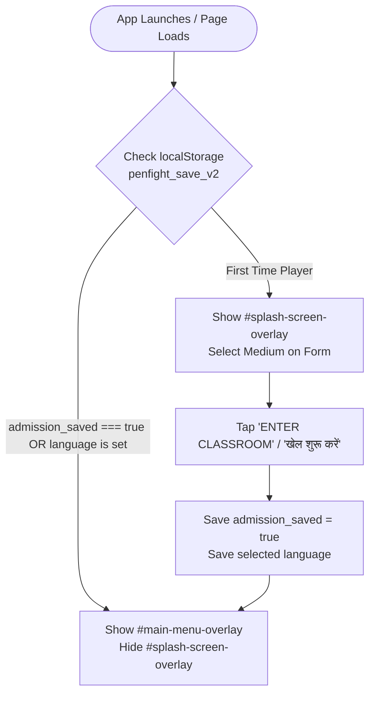

# Multi-Language Architecture & Implementation Plan: 2-Medium Engine (`english` vs `hindi`)

## Executive Summary
Architectural specification for a **100% Offline, Zero-Dependency 2-Medium Language Engine** (`english` vs `hindi`).
- **English Medium (`english`)**: 100% Original UI untouched. Every single label, heading, button, and school term remains identical to the existing codebase (`STUDENT BATTLE PASS`, `TOSS & PLAY`, `Story Mode`, `Pass & Play`, `Compass Box`, `Trophy Rack`, `1st Bencher`, `Desk Regular`, `Monitor`, `RECESS TIMEOUT!`, etc.). Not a single English word altered.
- **Hindi Medium (`hindi`)**: Simple, casual UI for everyday users. Every visible label, button, HUD pill, and dynamic certificate string translates into clean, natural Hindi without artificial bureaucratic jargon or English leaks.
- **No Third "Hinglish" Tab**: Strict binary toggle across all screens.
- **Preserved Invariants**: Dynamic School Name (`#student-school-input` + `window.applySchoolName()`), `.pencil-btn-tactile` button styles, dynamic locker pens, Rapier.js 120Hz physics, and Three.js rendering remain 100% intact.

---

## 1. Dedicated Module (`js/i18n.js`)

Zero external dependencies. Self-bootstrapping module loaded before UI controllers.

### 1.1 Storage & State
- **Storage Key**: `penfight_save_v2.settings.language`
- **Allowed Values**: `'english'` (default) | `'hindi'`
- **Fallback**: Defaults to `'english'` if unset.

### 1.2 Core API
```javascript
window.t(key, vars = {}) // Returns translated string; falls back to English, then to key
window.getGameLanguage()  // Returns 'english' | 'hindi'
window.setGameLanguage(lang) // Updates localStorage, updates [data-i18n], triggers UI updates
window.toggleMedium()     // Cycles between 'english' and 'hindi'
```

---

## 2. Terminology Mapping & Dictionaries

### 2.1 Admission Form (`#splash-screen-overlay`)
| UI Element | English Medium (`english`) | Hindi Medium (`hindi`) |
| :--- | :--- | :--- |
| Header Pill | `PERIOD: RECESS • BENCH #4` | `पीरियड: लंच ब्रेक • बेंच #4` |
| Title | `STUDENT BATTLE PASS` | `खिलाड़ी पहचान पत्र` |
| Roll / Class | `ROLL: #14` / `CLASS: 7th - B` | `रोल: #14` / `कक्षा: 7वीं - ब` |
| Medium Label | `🏫 MEDIUM / माध्यम:` | `🏫 माध्यम:` |
| Medium English Btn | `📖 English Medium` | `📖 English Medium` |
| Medium Hindi Btn | `🇮🇳 हिंदी मीडियम` | `🇮🇳 हिंदी मीडियम` |
| Player Name Label | `✎ KHILADI KA NAAM (ENTER NAME):` | `✎ अपना नाम लिखें:` |
| Player Name Input | Placeholder: `Enter Name` | Placeholder: `अपना नाम दर्ज करें` |
| School Name Label | `🏫 SCHOOL KA NAAM (OPTIONAL):` | `🏫 स्कूल का नाम (वैकल्पिक):` |
| School Name Input | Placeholder: `SARASWATI VIDYALAYA (Default)` | Placeholder: `सरस्वती विद्यालय (डिफ़ॉल्ट)` |
| House / Rank Labels | `HOUSE:` / `RANK:` | `सदन (हाउस):` / `रैंक:` |
| Primary Weapon | `PRIMARY WEAPON:` | `मुख्य पेन (हथियार):` |
| Speed / Grip | `Speed / Velocity` / `Table Grip` | `रफ़्तार / गति` / `टेबल पर पकड़` |
| CTA Button | `ENTER CLASSROOM ➔` | `खेल शुरू करें ▶` |
| Rule Footer | `Rule #1: Desk se neeche gira pen out maana jayega!` | `नियम #1: डेस्क से नीचे गिरा पेन आउट माना जाएगा!` |

### 2.2 Main Menu (`#main-menu-overlay`)
| UI Element | English Medium (`english`) | Hindi Medium (`hindi`) |
| :--- | :--- | :--- |
| Header Pill | `RECESS BREAK • BENCH #4` | `लंच ब्रेक • बेंच #4` |
| Header Medium Toggle | `📖 ENG MED.` | `🇮🇳 हिंदी मीडियम` |
| Subtitle Pill | `Classroom Championship • 1998 Edition` | `क्लासरूम प्रतियोगिता • 1998 संस्करण` |
| Profile Card Title | `STUDENT BATTLE PASS` | `खिलाड़ी प्रोफ़ाइल` |
| Level / XP | `LEVEL 02 • FRONT BENCHER` | `लेवल 02 • आगे बैठने वाले` |
| Quick Duel CTA | `TOSS & PLAY` / `VS BOT` | `⚡ तुरंत खेलें (VS CPU)` |
| Mode 1: Story | `Story Mode / Levels` (`OPEN CAMPAIGN ➔`) | `लेवल मैच (1 - 11)` (`खेलें ➔`) |
| Mode 2: Pass & Play | `Pass & Play / 2 Players` (`START 2P DUEL ⇄`) | `2 खिलाड़ी (1 फोन)` (`खेलें ⇄`) |
| Mode 3: Compass Box | `Compass Box / My Pens` (`OPEN PENCIL BOX 🖊️`) | `मेरे पेन` (`खोलें 🖊️`) |
| Mode 4: Trophy Rack | `Trophy Rack / Records` (`INSPECT CABINET 🏆`) | `ट्रॉफी व इनाम` (`देखें 🏆`) |

### 2.3 Match Setup Modal (`#match-setup-overlay`)
| UI Element | English Medium (`english`) | Hindi Medium (`hindi`) |
| :--- | :--- | :--- |
| Tabs | `Single Player (VS CPU)` / `Pass & Play (2P)` | `कंप्यूटर से खेलें` / `2 खिलाड़ी (दोस्त)` |
| Difficulty: Easy | `1st Bencher (Easy)` | `आसान (Easy)` |
| Difficulty: Medium | `Desk Regular (Normal)` | `सामान्य (Medium)` |
| Difficulty: Hard | `Monitor (Hard 🔥)` | `कठिन (Hard 🔥)` |
| Start Match CTA (1P) | `START DESK DUEL ▶` | `मैच शुरू करें ▶` |
| Start Match CTA (2P) | `START 2-PLAYER DUEL ▶` | `2-खिलाड़ी मैच शुरू करें ▶` |
| Bench Rule | `Desk Rule: Out upon table boundary breach!` | `डेस्क नियम: टेबल से नीचे गिरते ही खिलाड़ी आउट!` |

### 2.4 In-Game HUD (`#game-hud-overlay` & `js/hud.js`)
| UI Element | English Medium (`english`) | Hindi Medium (`hindi`) |
| :--- | :--- | :--- |
| Recess Strip | `RECESS PERIOD 4 • BENCH #1` | `लंच पीरियड 4 • बेंच #1` |
| Round Badge | `ROUND {cur} / {max}` | `राउंड {cur} / {max}` |
| Player 1 Tag | `YOU` | `आप` |
| Player 2 Tag (Bot) | `BOT` | `कंप्यूटर` |
| Player 2 Tag (Human) | `P2` | `खिलाड़ी 2` |
| Turn Pill (P1) | `YOUR TURN 🎯` | `आपकी बारी 🎯` |
| Turn Pill (Rival) | `RIVAL TURN ⏳` | `विरोधी की बारी ⏳` |
| Turn Pill (P2) | `PLAYER 2 TURN 🎯` | `खिलाड़ी 2 की बारी 🎯` |
| First-Shot Hint Pill | `👆 Pull your pen back & release to shoot!` | `👆 अपने पेन को पीछे खींचें और निशाना लगाकर छोड़ दें!` |
| Banner: Knockout | `KNOCKOUT! 💥` | `नॉकआउट! 💥` |
| Banner: Table Fall | `TABLE FALL! 💨` | `टेबल से बाहर गिरे! 💨` |
| Banner: Double Fall | `DOUBLE TABLE FALL! 💥` | `दोनों पेन गिरे! टाई! 💥` |
| Banner: Timeout | `RECESS TIMEOUT! ⏸️` | `समय समाप्त! ⏸️` |

### 2.5 Pause Menu (`#pause-menu-modal`)
| UI Element | English Medium (`english`) | Hindi Medium (`hindi`) |
| :--- | :--- | :--- |
| Title | `RECESS TIMEOUT! ⏸️` | `गेम रुका हुआ है ⏸️` |
| Warning | `PT TIWARI SIR ON ROUND!` | `पीटी तिवारी सर राउंड पर हैं!` |
| Medium Label | `MEDIUM / माध्यम:` | `भाषा माध्यम:` |
| Resume Button | `RESUME DUEL ⏱️` | `खेल जारी रखें ▶` |
| Restart Button | `RESTART ROUND 🔄` | `राउंड फिर से शुरू करें 🔄` |
| Quit Button | `QUIT TO CLASSROOM HUB 🚪` | `होम स्क्रीन पर जाएं 🏠` |

### 2.6 Match Result Overlay (`#match-result-overlay` & `js/match_result.js`)
| UI Element | English Medium (`english`) | Hindi Medium (`hindi`) |
| :--- | :--- | :--- |
| Victory Title | `PASSED WITH DISTINCTION!` | `शानदार जीत! ✪` |
| Defeat Title | `FAILED! PEN FELL OFF DESK!` | `हार! टेबल से बाहर गिरे! 💔` |
| Next Classmate Btn | `NEXT CLASSMATE ➔` | `अगला सहपाठी ➔` |
| Rematch Btn (1P) | `REMATCH (RETRY DUEL) 🔄` | `दोबारा खेलें 🔄` |
| Rematch Btn (2P) | `REMATCH (P1 vs P2) ⚔️` | `दोबारा मुकाबला (P1 vs P2) ⚔️` |
| Return to Hub Btn | `RETURN TO CLASSROOM HUB 🚪` | `होम पर जाएं 🚪` |

### 2.7 Trophy Cabinet & Settings (`#trophy-cabinet-overlay` & `js/trophy_cabinet.js`)
| UI Element | English Medium (`english`) | Hindi Medium (`hindi`) |
| :--- | :--- | :--- |
| Tabs | `Enamel Pins` / `Milestones` / `Recess Rules` / `Settings` | `पदक (पिन्स)` / `उपलब्धियां` / `नियम` / `सेटिंग्स` |
| Settings Medium Title | `Medium / भाषा माध्यम` | `भाषा माध्यम (Medium)` |
| Audio SFX | `Audio & Recess SFX` | `साउंड व आवाज (SFX)` |
| Ambiance | `Classroom Murmur Chatter` | `क्लासरूम की आवाज` |

---

## 3. UI Selector Placement (Only 2 Medium Buttons)

1. **Admission Form (`#splash-screen-overlay`)**:
   - Location: Under House/Rank row, right above Primary Weapon box.
   - Layout: Label `🏫 MEDIUM / माध्यम:` with two tactile toggle buttons:
     - `📖 English Medium` (`#splash-med-english-btn`)
     - `🇮🇳 हिंदी मीडियम` (`#splash-med-hindi-btn`)
   - Click behavior: Calls `window.setGameLanguage('english')` or `'hindi'`, live updating all labels and placeholders on the form immediately.
2. **Main Menu Header (`#main-menu-overlay`)**:
   - Location: Right beside `#settingsBtn`.
   - Layout: Tactile button `#menu-medium-toggle-btn` containing `#menu-medium-toggle-text` (`📖 ENG MED.` or `🇮🇳 हिंदी मीडियम`).
   - Click behavior: Calls `window.toggleMedium()`, seamlessly toggling language across the entire application.
3. **Settings (`#cabinet-view-settings`) & Pause Menu (`#pause-menu-modal`)**:
   - Location: Dedicated rows in each modal.
   - Layout: 2 buttons (`📖 English Medium` | `🇮🇳 हिंदी मीडियम`) with active highlight indicator.

---

## 4. Smart Launch Routing



---

## 5. First-Shot Visual Finger Guide (`#hud-first-shot-hint`)

- Inside `#game-hud-overlay`, placed at the bottom center:
  ```html
  <div id="hud-first-shot-hint" class="pointer-events-none px-3.5 py-1.5 rounded-full bg-white/95 border-2 border-slate-900 shadow-[0_3px_0_0_#0f172a] text-[#00288e] text-[11px] font-bold tracking-wide flex items-center gap-1.5 animate-bounce select-none" data-i18n="hud.first_shot_hint">
    👆 Pull your pen back & release to shoot!
  </div>
  ```
- In `js/main.js`:
  ```javascript
  // Inside onPointerDown
  const hint = document.getElementById('hud-first-shot-hint');
  if (hint && hint.style.display !== 'none') {
    hint.style.display = 'none';
  }
  ```

---

## 6. Execution Order

1. **Write `D:\FInal\js\i18n.js`**: Complete 2-Medium dictionary pack and translation controllers.
2. **Update `D:\FInal\index.html`**:
   - Add `<script src="./js/i18n.js?v=p4_i18n_v2"></script>` before UI controllers.
   - Add `data-i18n` and `data-i18n-placeholder` attributes across all elements.
   - Insert 2-Medium selectors on Admission Form, Main Menu, Pause Menu, and Settings.
   - Insert `#hud-first-shot-hint` in HUD.
   - Implement Smart Launch check in initialization script.
3. **Update `D:\FInal\js\hud.js`**: Wire dynamic round label, turn indicator text, and referee banners to `window.t(...)`.
4. **Update `D:\FInal\js\match_result.js`**: Wire dynamic certificate titles, scores, and button labels to `window.t(...)`.
5. **Update `D:\FInal\js\trophy_cabinet.js`**: Wire badge titles and settings strings to `window.t(...)`.
6. **Update `D:\FInal\js\main.js`**: Wire `onPointerDown` first-shot hint dismissal.
7. **Verification**: Run local tests, verify 390x844 layout, check both mediums, and take screenshots.
